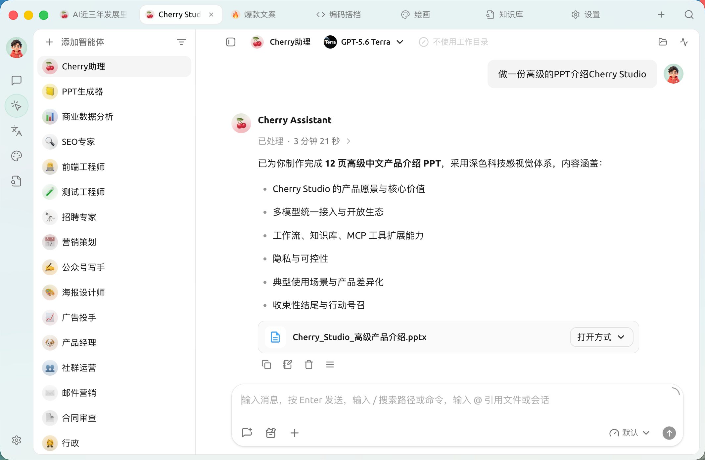
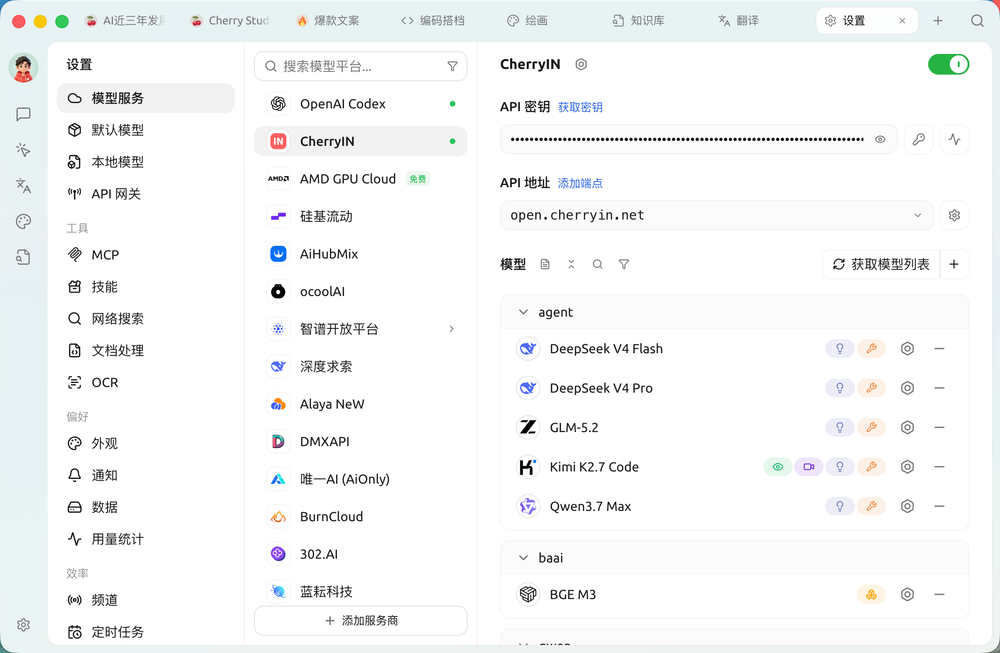

# SuperAgent 

SuperAgent 

[****](getting-started/quick-start.md)

[****](#)

[****](question-contact/questions.md)

## 

 ·  · 

## 

 ·  ·  ·  · 

## 

 ·  · [ MCP](advanced-basic/extensions/README.md) · 

## 

 · [API ](advanced-basic/developer-tools/api-gateway.md) ·  · 

## 

 · [AI ](question-contact/knowledge.md) ·  · 

## 

 ·  · [MCP ](advanced-basic/extensions/mcp/troubleshooting.md) · 

## 

 ·  · 

## 

 ·  · 

***

<figure><figcaption></figcaption></figure>

[(X)](https://x.com/SuperAgentHQ)

[QQ ](https://qm.qq.com/q/lo0D4qVZKi)[Telegram](https://t.me/SuperAgentAI)[Discord](https://discord.gg/wez8HtpxqQ)

***

SuperAgent AI  AI SuperAgent  AI  SuperAgent  AI 

<figure><figcaption></figcaption></figure>

<figure><figcaption></figcaption></figure>

***

### ****

#### **1. **

* **** 
* ****
* **** MarkdownWord 
* ****
* ****
* **** Markdown HTML 

#### **2. **

* **** ****  
* **Skill**"" 
* **MCP** Model Context Protocol NotionGitHub  [MCP ](advanced-basic/extensions/mcp/README.md)
* **** /  / Telegram / Discord  IM  
* **** 

#### **3. **

* **AI **
* **AI ** Web  AI 
* ****
* **** Markdown 
* ****
* ****

#### **4. **

* **** OpenAIGeminiAnthropicAzure 
* ****
* **** API 
* ****
* **** OpenAIGemini Anthropic 

#### **5. **

* ** CSS**
* ****
* ****
* ****

#### **6. **

* **** PDFDOCXPPTXXLSXTXTMD 
* ****
* ****
* ****

#### **7. **

* ****
* **** AI 
* ****
* ****
* ****

#### **8. **

* ****WebDAV 
* ****

***

### ****

1. ****SuperAgent 
2. ****
3. ****
4. ****

***

### ****

* ****
* ****
* ****
* **AI **

### Star History

<a href="https://star-history.dera.page/#DrOlu/SuperAgent&amp;Date">
  <picture>
    <source media="(prefers-color-scheme: dark)" srcset="https://star-history.dera.page/svg?repos=DrOlu/SuperAgent&amp;type=Date&amp;theme=dark" />
    <source media="(prefers-color-scheme: light)" srcset="https://star-history.dera.page/svg?repos=DrOlu/SuperAgent&amp;type=Date" />
    
  </picture>
</a>

## 

<table data-view="cards"><thead><tr><th></th><th data-hidden data-card-cover data-type="files"></th><th data-hidden data-card-target data-type="content-ref"></th></tr></thead><tbody><tr><td></td><td><a href=".gitbook/assets/1.webp">1.png</a></td><td><a href="https://www.xiaohongshu.com/user/profile/662b6853000000000b031d9a?xsec_token=YB_1nKvlH4r5hPYVVbbsNHF8Y6n6AKlm5-DaggPCtd2DQ%3D&#x26;xsec_source=app_share&#x26;xhsshare=CopyLink&#x26;appuid=662b6853000000000b031d9a&#x26;apptime=1738627324&#x26;share_id=ace5db41b5954fab8d98a2a7865a62bc&#x26;share_channel=copy_link">https://www.xiaohongshu.com/user/profile/662b6853000000000b031d9a?xsec_token=YB_1nKvlH4r5hPYVVbbsNHF8Y6n6AKlm5-DaggPCtd2DQ%3D&#x26;xsec_source=app_share&#x26;xhsshare=CopyLink&#x26;appuid=662b6853000000000b031d9a&#x26;apptime=1738627324&#x26;share_id=ace5db41b5954fab8d98a2a7865a62bc&#x26;share_channel=copy_link</a></td></tr><tr><td></td><td><a href=".gitbook/assets/3.webp">3.png</a></td><td><a href="https://b23.tv/hIfGgDW">https://b23.tv/hIfGgDW</a></td></tr><tr><td></td><td><a href=".gitbook/assets/2.webp">2.png</a></td><td><a href="https://weibo.com/u/7975656228">https://weibo.com/u/7975656228</a></td></tr><tr><td></td><td><a href=".gitbook/assets/4.webp">4.png</a></td><td><a href="https://v.douyin.com/ifTpX4X7">https://v.douyin.com/ifTpX4X7</a></td></tr><tr><td><a href="https://x.com/SuperAgentHQ?t=DYR0ulaLur-bO4Us3bG79A&#x26;s=05">(X)</a></td><td><a href=".gitbook/assets/5.webp">5.png</a></td><td><a href="https://x.com/SuperAgentHQ?t=DYR0ulaLur-bO4Us3bG79A&#x26;s=05">https://x.com/SuperAgentHQ?t=DYR0ulaLur-bO4Us3bG79A&#x26;s=05</a></td></tr></tbody></table>
