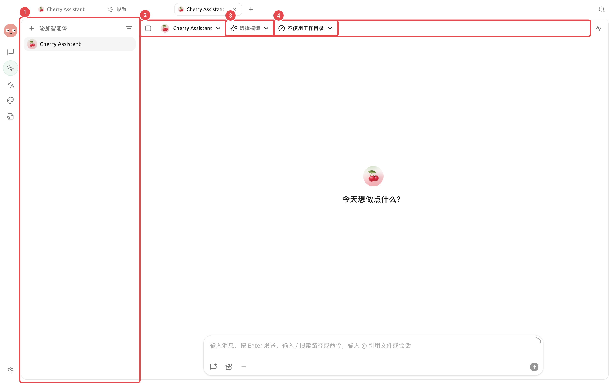
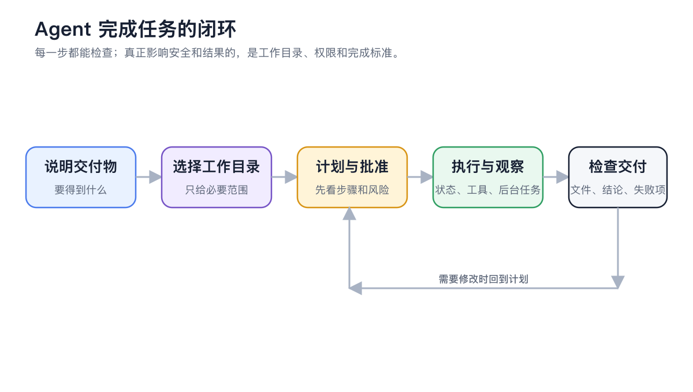

<a id="agent-gong-zuo-qu"></a>

# 






<figure><figcaption></figcaption></figure>

<figure><figcaption></figcaption></figure>

### 

|  |  |  |
| ----- | ----------------- | ----------------- |
|  |  |  |
|  |  |  |
|  |  |  |
|  |  |  |
|  |  |  |

### 



<a id="1-da-kai--gong-zuo--bing-xuan-ze-agent"></a>
<a id="1--agent"></a>

#### 1. 





#### 2. 





#### 3. 


```
 action-items.md
```



#### 4. 





### API 

 SuperAgent  API →API 


API  URL  API 


<a id="yi-ge-agent-hai-shi-duo-ge-agent"></a>
<a id="-agent--agent"></a>

### 

* 
* 
* 

### 

“”

<details>

<summary></summary>

MCP 

</details>

<details>

<summary></summary>

 SuperAgent 

</details>
