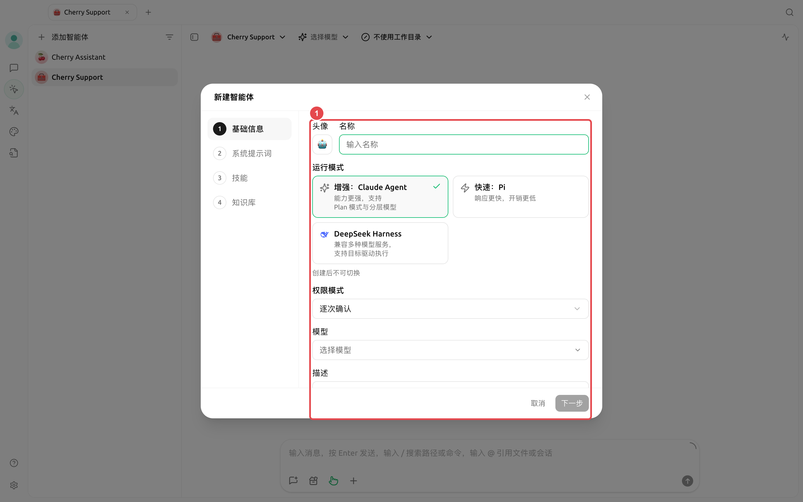
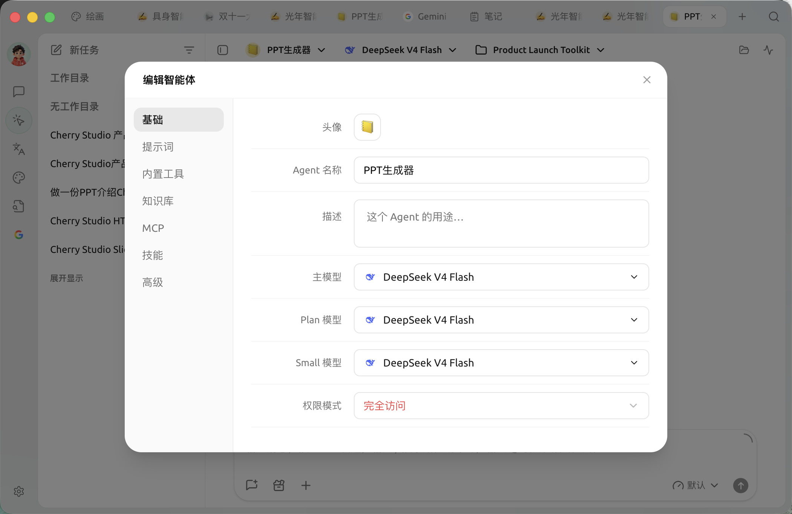

# 

→

<figure><figcaption></figcaption></figure>

### 

|  |  |  |  |
| ------------------ | ------------------- | -------------------- | ------------------------------------ |
| Claude Agent |  | Plan Small  |  |
| Pi |  |  |  |
| DeepSeek Harness |  |  |  `/compact``/goal` |





### 



#### 1. 

“”“”



#### 2. 




#### 3. 

→



#### 4. 




<figure><figcaption>
 Plan  Small 
</figcaption></figure>

### 

* 
* 
* 
* 
* MCP MCP 
* 
* 





### 

|  |  |  |  |  |  |
| --------------- | ----------------------------- | ----------------------- | -------------- | ------------------ | ---------------------------------- |
|  | Claude Agent | Claude Agent |  |  |  |
|  |  |  |  |  |  |
| Plan / Small  |  |  |  | Claude Agent | Pi  DeepSeek Harness  |
|  | Claude/DSH Pi  |  |  |  |  |
|  |  30  |  |  | Claude Pi | DeepSeek Harness  |

### 

“”“”

 MCP 

MCP

