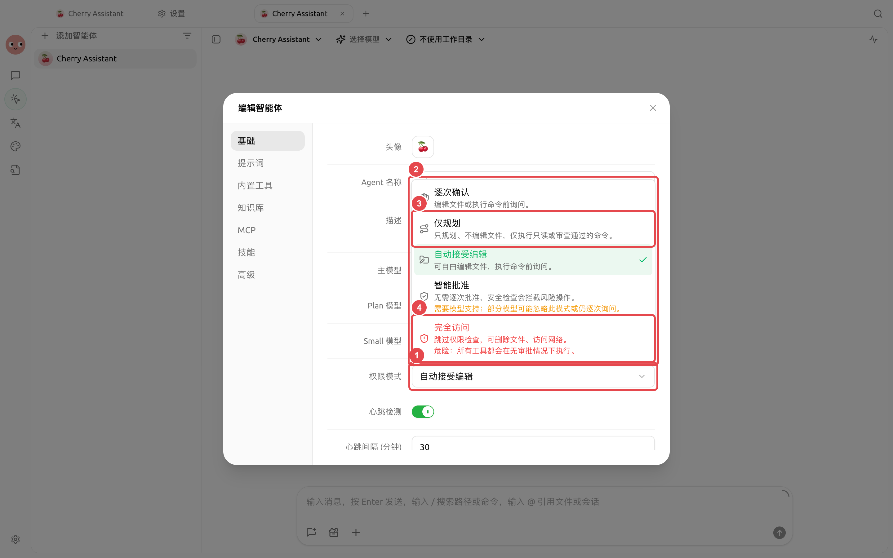
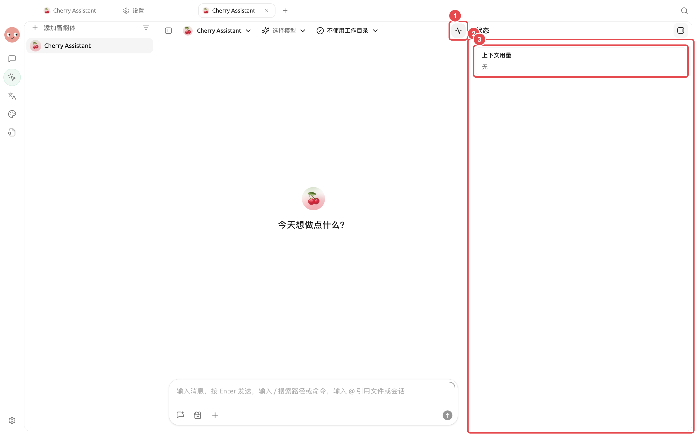

# 

“”“”“”

<figure><figcaption><p></p></figcaption></figure>

### 

|  |  |  |  |
| -------- | ------------- | ------------- | ---------------- |
|  |  |  |  |
|  |  |  |  |
|  |  |  |  |
|  |  |  |  |
|  |  |  |  |

 `mise` 

Pi  Pi DeepSeek Harness Claude Agent

→ →→→





<a id="agent-ji-yi"></a>
<a id="agent-"></a>

### 


```

```

API Key

### 


* 
* 
* 
* 
* 

→→

<figure><figcaption><p></p></figcaption></figure>

### 


<details>

<summary></summary>


</details>

<details>

<summary></summary>


</details>
