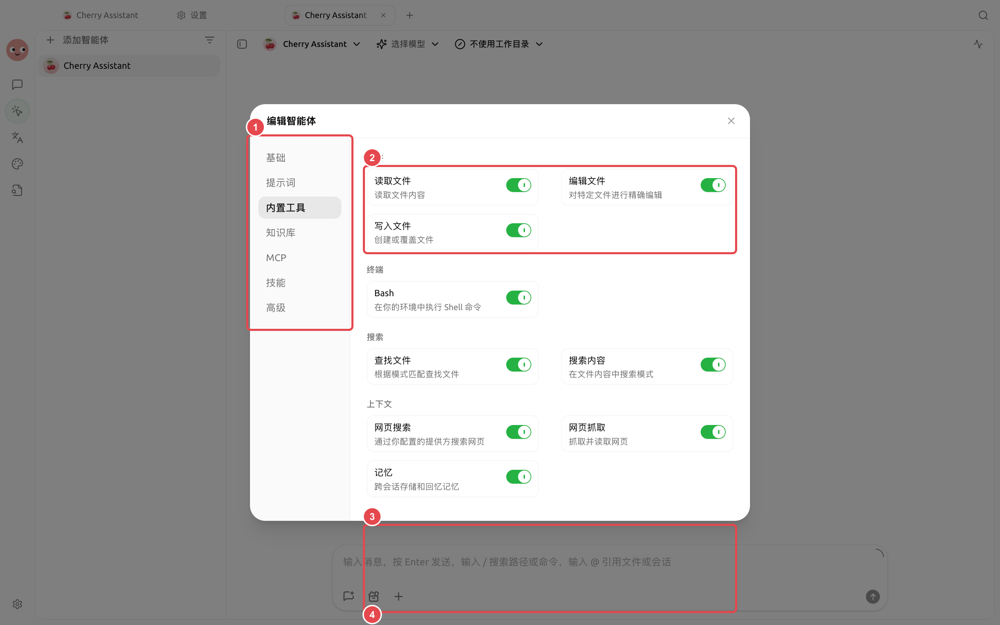

#  MCP

MCP 

### 

<figure><figcaption></figcaption></figure>

|  |  |  |
| ---- | ----------------------------- | ------------------------- |
|  |  SuperAgent  |  |
|  |  |  |
|  |  |  |
| MCP |  |  |

→ →→

### 

* 
* 
*  SuperAgent 
* 
* 
* Task
*  Markdown PDFWordPowerPointExcelOpenDocumentRTFEPUB  CSV
* 
*  Bash 


 Markdown PDF  OCROCR


### 

### 

→

### MCP

→MCPMCP+





### 

|  |  |  |  |
| -------- | ------------- | ------------- | ------------- |
|  |  +  |  |  |
|  |  +  |  |  |
|  |  +  |  MCP |  |
|  | MCP +  |  |  |

### 

“” MCP

