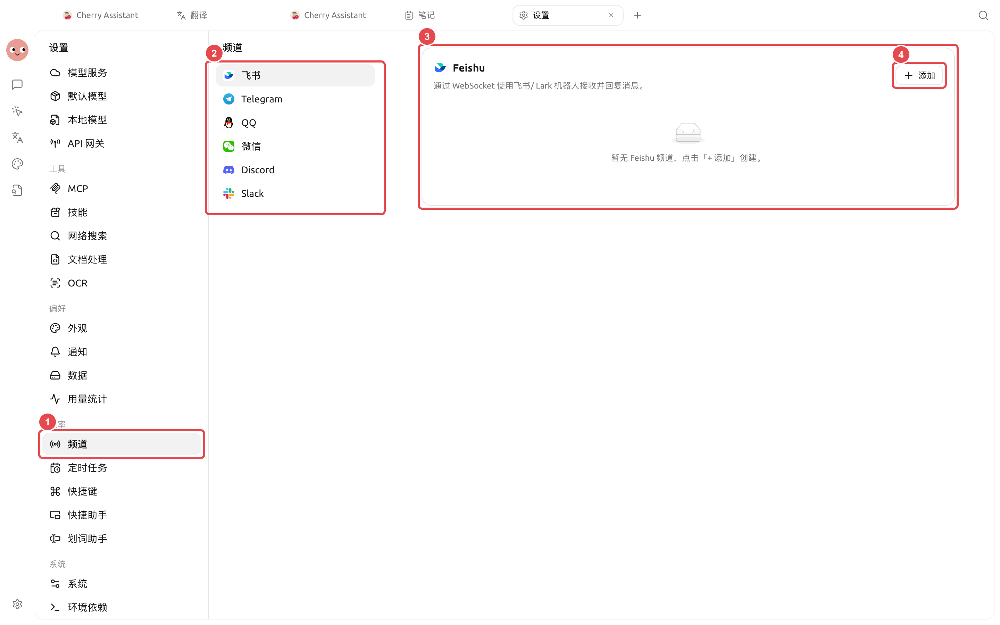
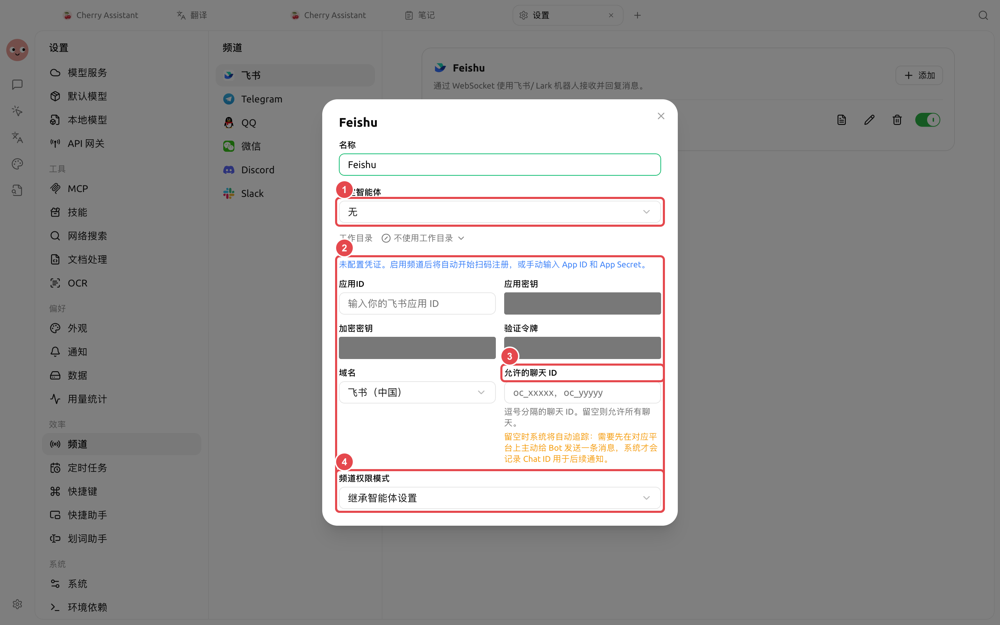

# 

TelegramQQDiscord  Slack


“”→


<figure><figcaption>

</figcaption></figure>

## 

→→→



### 1. 

 Token 



<figure><figcaption>

</figcaption></figure>

### 2. 




### 3. 

 Chat ID ID  ID `/whoami` 



### 4. 




## 

|  |  |  |  |  |  |
| -------- | --------- | --------------- | ------------ | --------- | ---------------- |
|  |  |  |  |  |  |
|  |  |  |  |  |  |
|  |  |  |  |  |  |
|  |  |  |  |  |  |

## 

“”“”

### 

## 

|  |  |  |
| --------- | ----------------------- | ------------------ |
|  / Lark | App IDApp Secret |  ID / |
| Telegram | Bot Token | Chat ID |
| QQ | App IDClient Secret |  |
|  |  |  ID |
| Discord | Bot Token |  ID |
| Slack | Bot TokenApp Token | Socket Mode  ID |


 TokenApp Secret  Issue


 SuperAgent  Chat ID

 ID API 

