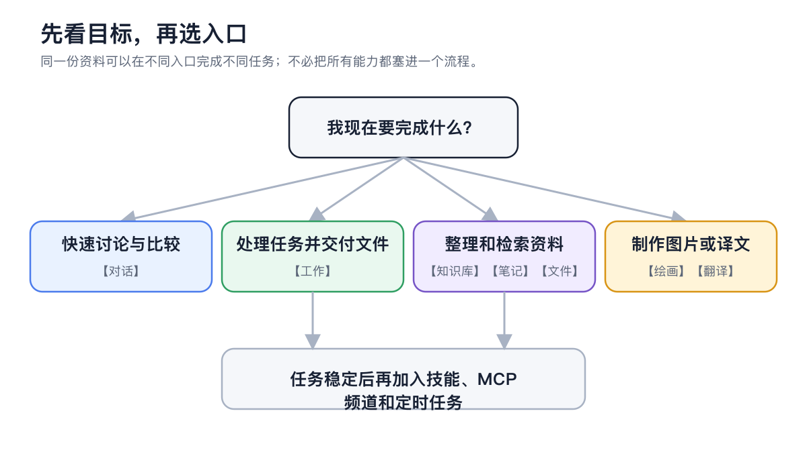
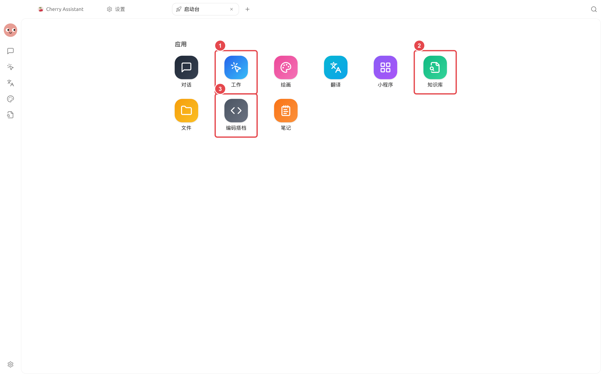

# 

“”

<figure><figcaption>
MCP
</figcaption></figure>





<figure><figcaption>

</figcaption></figure>

MCP

### 

|  |  |  |
| ------------- | ----------------------- | --------------------- |
|  |  |  |
|  |  |  |
|  | → | //RAG |
|  |  |  |
|  |  | OCR |
|  |  | Markdown |
|  | → | OCR |
|  |  |  |
|  |  |  |
|  |  | MCP |
|  |  |  |
|  |  |  |
|  | → |  |
|  |  | Code CLI |
|  | →API / |  API |

### 




#### 1. 




#### 2. 

 MCP



#### 3. 

Code CLI  API



### 

<table data-view="cards"><thead><tr><th></th><th></th><th data-hidden data-card-target data-type="content-ref"></th></tr></thead><tbody><tr><td><strong></strong></td><td></td><td><a href="chat/README.md">chat/README.md</a></td></tr><tr><td><strong></strong></td><td></td><td><a href="agent-workspace/README.md">agent-workspace/README.md</a></td></tr><tr><td><strong></strong></td><td></td><td><a href="knowledge-content/README.md">knowledge-content/README.md</a></td></tr><tr><td><strong></strong></td><td> MCP</td><td><a href="extensions/README.md">extensions/README.md</a></td></tr><tr><td><strong></strong></td><td></td><td><a href="automation/README.md">automation/README.md</a></td></tr><tr><td><strong></strong></td><td></td><td><a href="workbench/README.md">workbench/README.md</a></td></tr><tr><td><strong></strong></td><td>Code CLIAPI </td><td><a href="developer-tools/README.md">developer-tools/README.md</a></td></tr><tr><td><strong></strong></td><td></td><td><a href="cases/README.md">cases/README.md</a></td></tr></tbody></table>


MCP API Key

