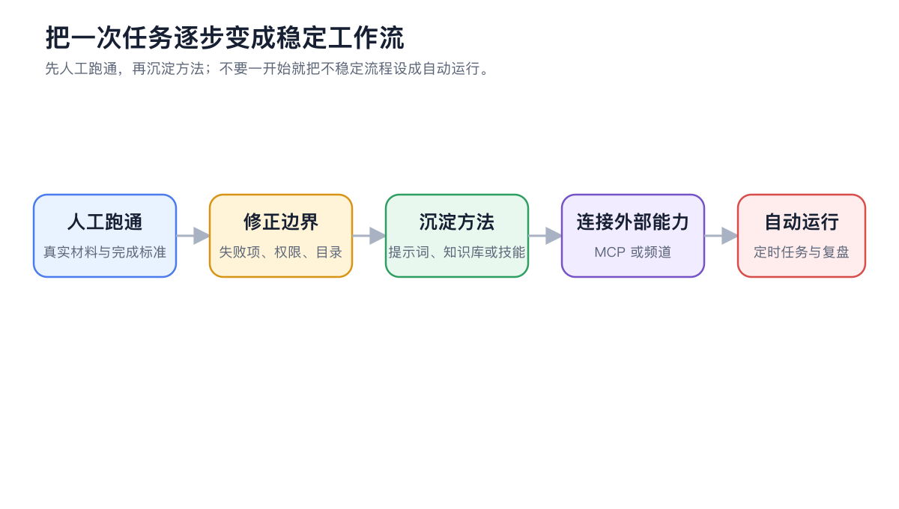
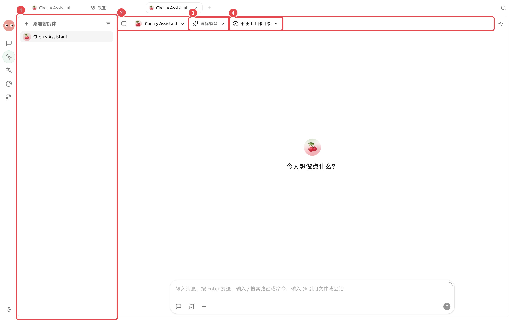

# 

<figure><figcaption>
MCP
</figcaption></figure>

## 

<table data-view="cards"><thead><tr><th></th><th></th><th data-hidden data-card-target data-type="content-ref"></th></tr></thead><tbody><tr><td><strong></strong></td><td></td><td><a href="research-review.md">research-review.md</a></td></tr><tr><td><strong></strong></td><td></td><td><a href="long-document-review.md">long-document-review.md</a></td></tr><tr><td><strong></strong></td><td></td><td><a href="project-delivery.md">project-delivery.md</a></td></tr><tr><td><strong></strong></td><td></td><td><a href="brand-image-kit.md">brand-image-kit.md</a></td></tr><tr><td><strong></strong></td><td></td><td><a href="private-knowledge-qa.md">private-knowledge-qa.md</a></td></tr><tr><td><strong></strong></td><td></td><td><a href="notes-weekly-report.md">notes-weekly-report.md</a></td></tr><tr><td><strong></strong></td><td>OCR</td><td><a href="multilingual-materials.md">multilingual-materials.md</a></td></tr><tr><td><strong></strong></td><td></td><td><a href="automated-daily-report.md">automated-daily-report.md</a></td></tr><tr><td><strong></strong></td><td></td><td><a href="multi-window-research.md">multi-window-research.md</a></td></tr></tbody></table>

## 

<figure><figcaption>

</figcaption></figure>

## 

|  |  |  |
| ----------- | -------------- | -------------- |
|  |  |  |
|  |  |  |
|  |  |  |
|  |  |  |
|  |  |  |
|  |  |  |
|  |  |  |
|  |  |  |
|  |  |  |



### 1. 




### 2. 




### 3. 




### 4. 

 MCP


