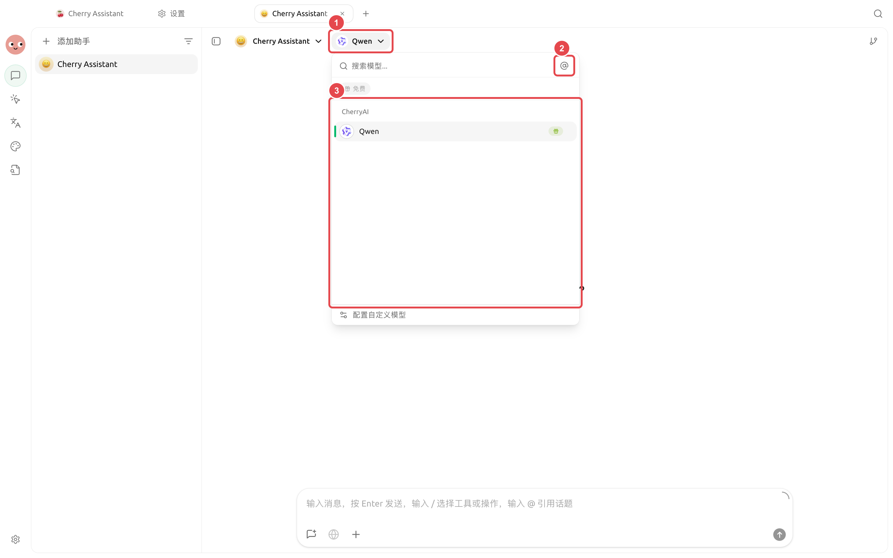
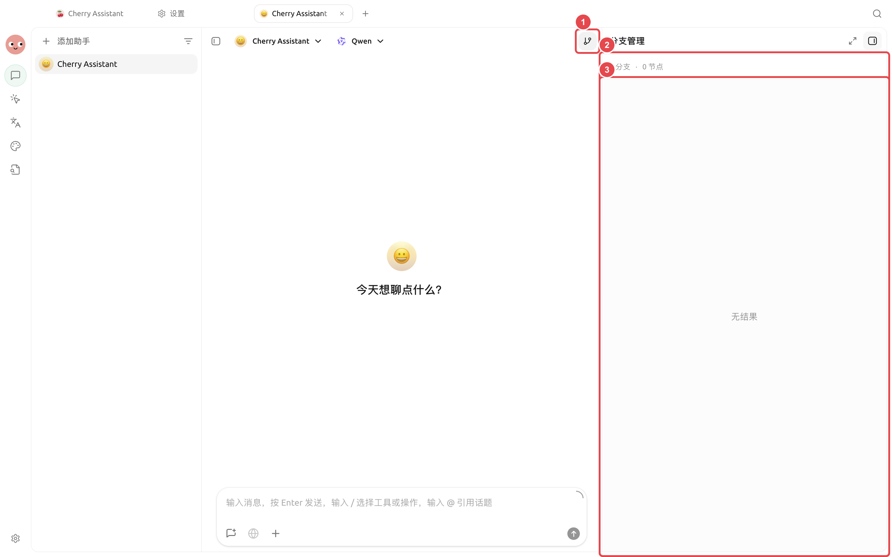
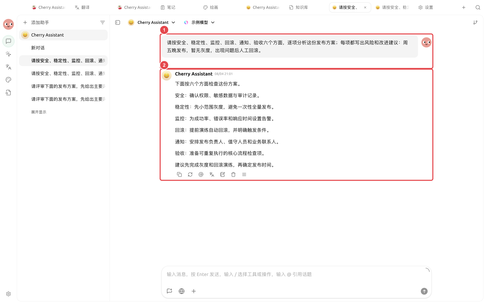

# 


<figure><figcaption><p></p></figcaption></figure>

<figure><figcaption><p></p></figcaption></figure>

<figure><figcaption><p>① ② </p></figcaption></figure>

## 

* 
* 
* 
*  MCP
* 

## 



### 1. 





<a id="2-chuang-jian-yan-jiu-agent"></a>
<a id="2--agent"></a>

### 2. 

 `report/` 



### 3. 





### 4. 





## 

```
 report/review.md  raw/ 
```

## 

|  |  |
| ---- | ------------------------------- |
|  |  |
|  |  |
|  |  |
|  |  |





