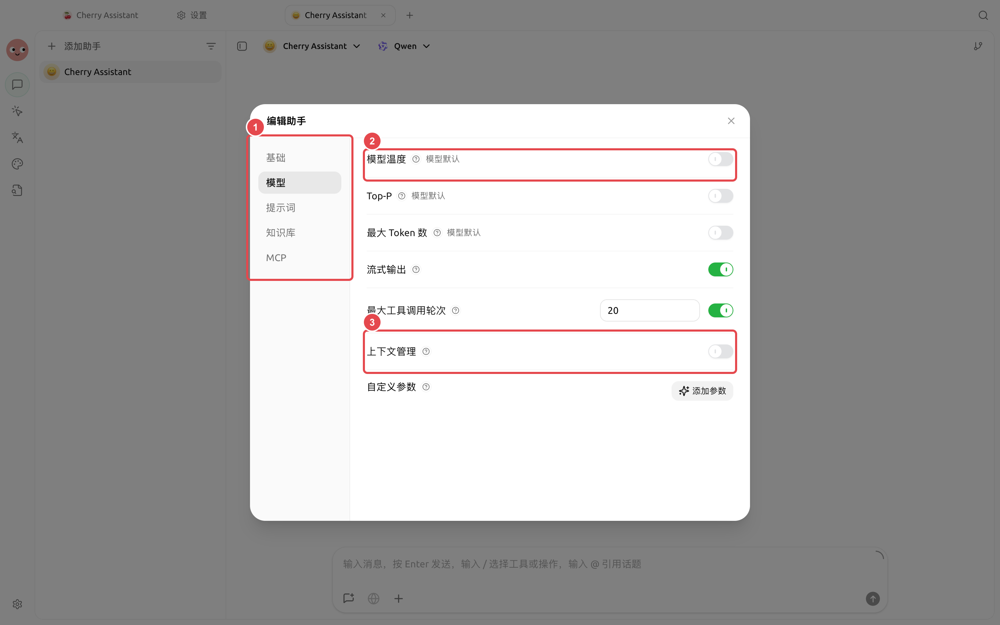
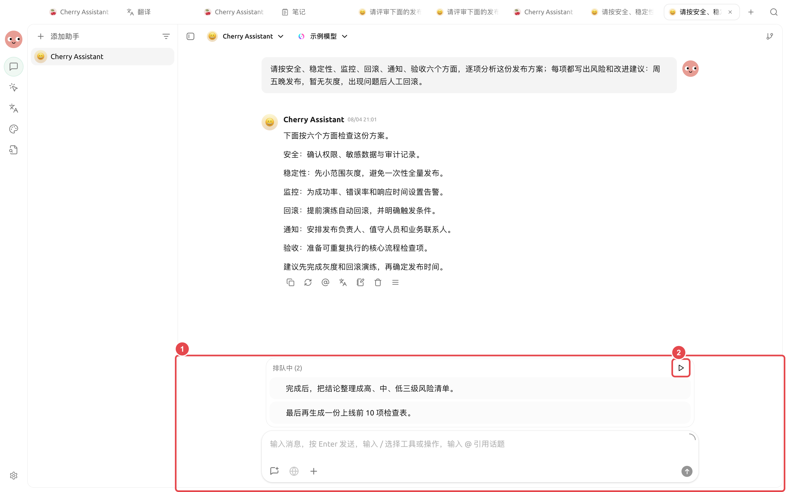

# 

“”

<figure><figcaption>

</figcaption></figure>

### 



#### 1. 




#### 2. 

“”“”



#### 3. 




### 

→→

|  |  |  |  |  |  |
| -------- | -------- | ------- | ------------- | ------------- | --------------- |
|  |  |  |  |  |  |
|  |  |  |  |  |  |
|  | 50000  |  |  |  |  |
|  |  |  |  |  |  |
|  |  |  |  |  |  |

→ 3 

### 

“”

<figure><figcaption>

</figcaption></figure>

① ② 





#### 

“”“”

