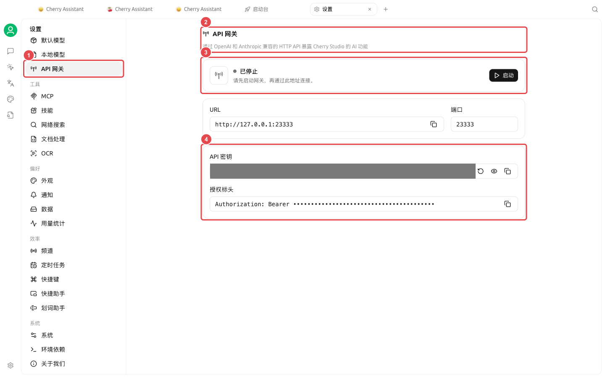

# 

 CLI

### 

|  |  |  |
| ----------------- | ---------------------------- | -------------- |
|  |  CLI |  |
| →API  |  API |  |
| →→ |  |  |

<figure><figcaption>
API 
</figcaption></figure>


API Issue 


<table data-view="cards"><thead><tr><th></th><th></th><th data-hidden data-card-target data-type="content-ref"></th></tr></thead><tbody><tr><td><strong>API </strong></td><td> API </td><td><a href="api-gateway.md">api-gateway.md</a></td></tr><tr><td><strong></strong></td><td></td><td><a href="trace.md">trace.md</a></td></tr></tbody></table>
