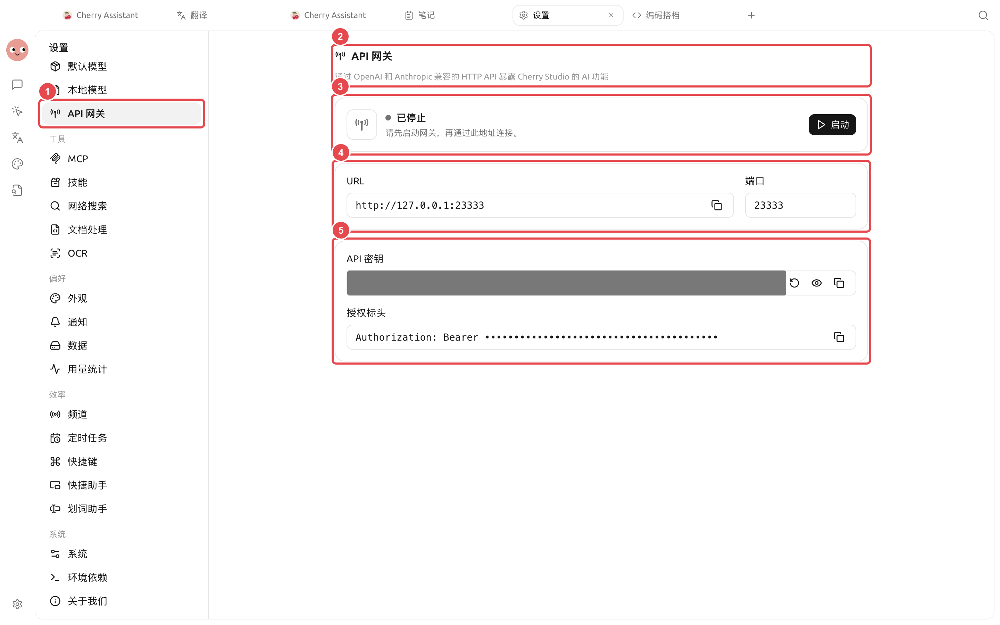

# API 

API  SuperAgent  OpenAI  Anthropic  HTTP API 

→API 

<figure><figcaption>

</figcaption></figure>

## 

*  SuperAgent  URL 
*  SuperAgent URL  API  API 
* 

## 



### 1. 




### 2. 

 URLAPI 



### 3. 

 `Authorization: Bearer <API >`



### 4. 

 API  HTTP 



## 

→ API  OpenAI  Anthropic 

|  |  |  |  |
| ------ | ---------- | --------- | ----------------- |
|  |  |  |  |
| API  |  |  |  |
|  |  |  |  |

### 

## 


API  SuperAgent 


* 
* Issue
* 
* → SuperAgent 

API 

API 

 `Authorization: Bearer ...`

