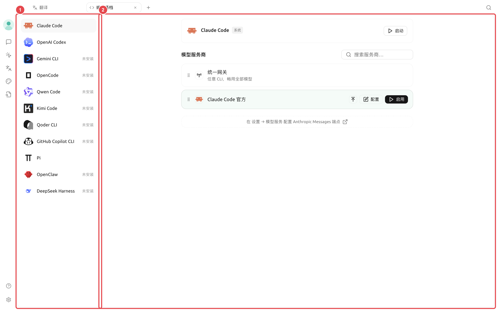
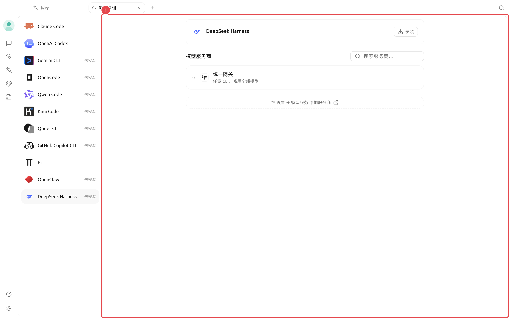

# Code CLI

SuperAgent  PATH 

<figure><figcaption>
① ② 
</figcaption></figure>

### 

* 
*  SuperAgent 
*  PATH 
*  CLI 
*  CLI 
* 

 Claude CodeOpenAI CodexGemini CLIOpenCodeQwen CodeKimi CodeQoder CLIGitHub Copilot CLIPi  DeepSeek Harness 

### 



#### 1. 

 SuperAgent 



#### 2. 

 CLI SuperAgent 



#### 3. 

 SuperAgent  CLI 



#### 4. 

 CLI 



#### 5. 




### DeepSeek Harness

<figure><figcaption>
①  Web UI
</figcaption></figure>

DeepSeek Harness  CLI  SuperAgent  Web UI

|  |  |  |
| -------- | -------------------------- | ------------- |
|  | Shell |  |
| PTC  |  Code Mode  |  |
|  |  Shell  |  |
|  |  |  |
|  |  DSH  |  |
|  |  |  |

### 

|  | SuperAgent  |  |
| ---------------- | ------------------ | ----------------- |
| SuperAgent  |  |  |
|  PATH |  |  |
|  |  |  |

<figure><figcaption></figcaption></figure>


 SuperAgent 


### 

 Pi  CLI

 CLI

SuperAgent 

 CLI

SuperAgent 

