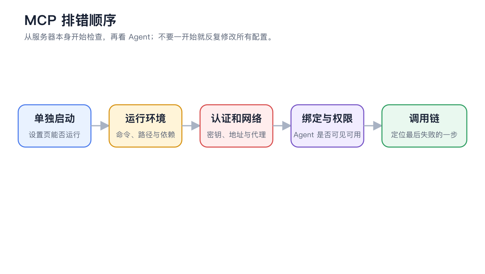

# 

 MCP 

<figure><figcaption>
 MCP 
</figcaption></figure>

### 



#### 1. →




#### 2.  SuperAgent




#### 3. 




#### 4. 




### 

|  |  |  |
| -------- | ------------------ | ---------------- |
|  | Token  |  |
|  |  |  |
| MCP  |  |  |
|  |  |  |
| HTTP  | URL |  |


 API KeyAuthorizationCookie


### MCP 

 MCP  MCP MCP

