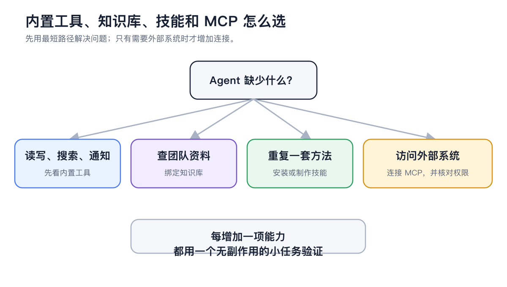
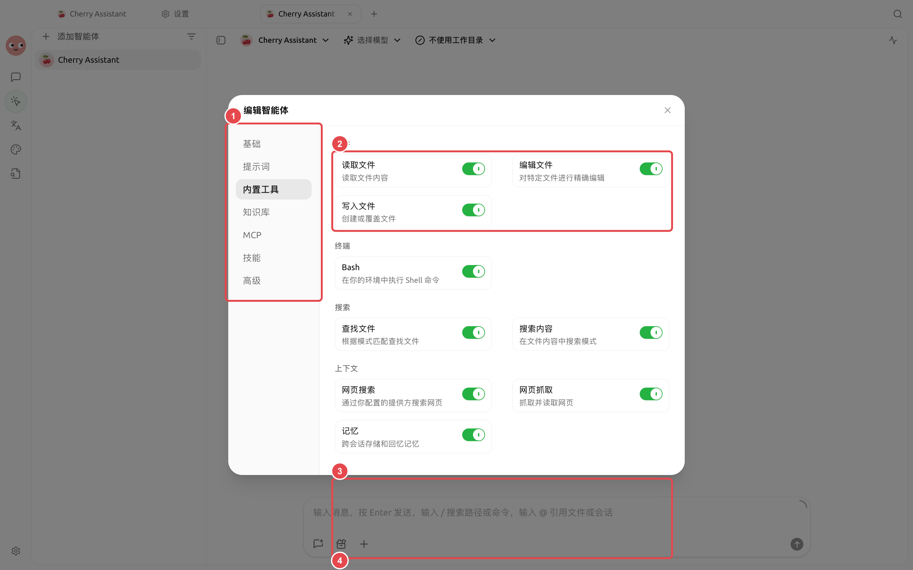

# 

 MCP“”

<figure><figcaption>
 MCP
</figcaption></figure>

## 

|  |  |
| ----------------- | ---------- |
|  |  |
|  | MCP |
|  |  |
|  |  |


MCP 


## 

→ →MCP

<figure><figcaption>
MCP 
</figcaption></figure>

<table data-view="cards"><thead><tr><th></th><th></th><th data-hidden data-card-target data-type="content-ref"></th></tr></thead><tbody><tr><td><strong></strong></td><td></td><td><a href="skills.md">skills.md</a></td></tr><tr><td><strong>MCP </strong></td><td></td><td><a href="mcp/">mcp</a></td></tr><tr><td><strong>MCP </strong></td><td></td><td><a href="mcp/troubleshooting.md">troubleshooting.md</a></td></tr></tbody></table>
