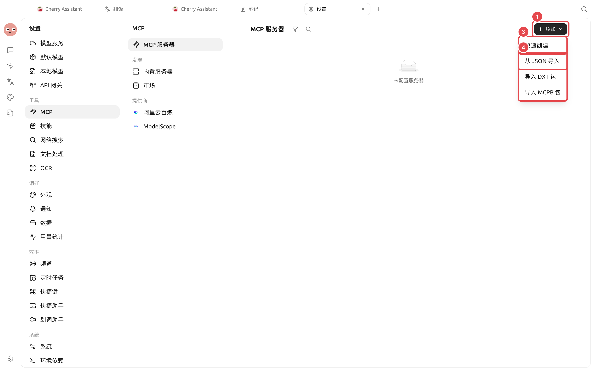
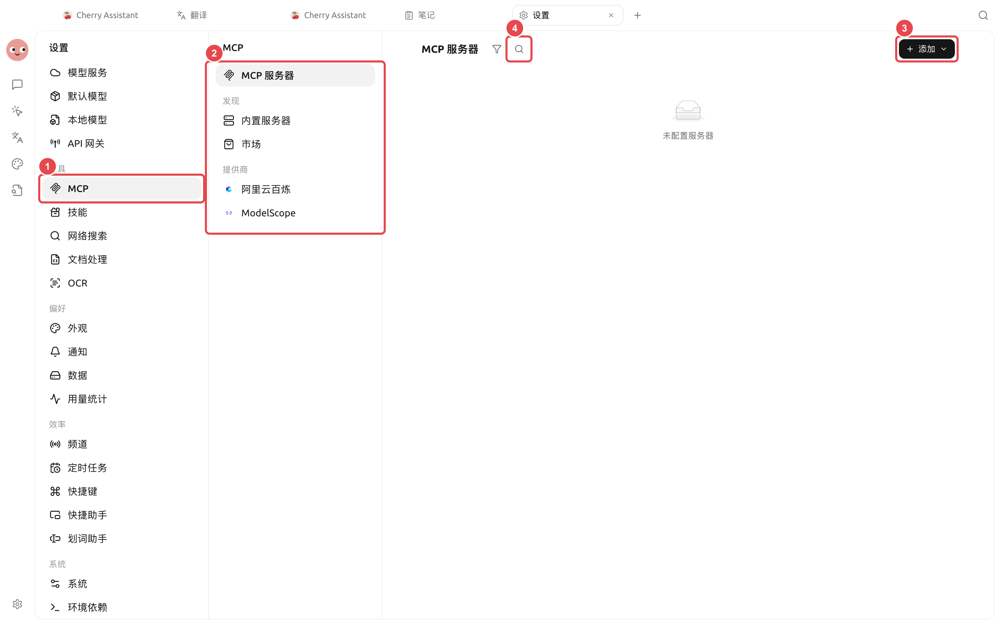
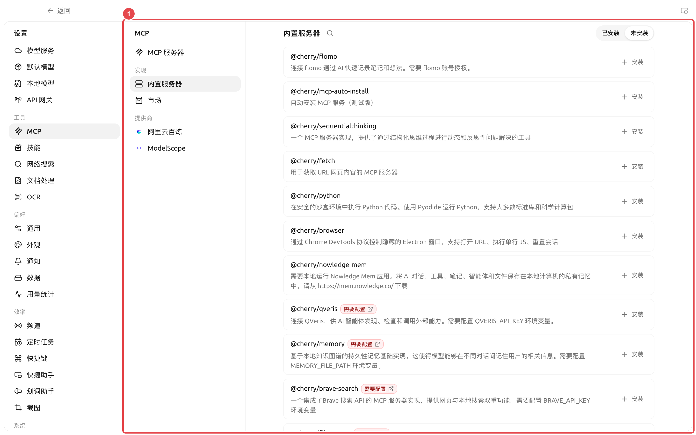

# MCP 

MCP SuperAgent  MCP 

###  MCP

<figure><figcaption></figcaption></figure>

<figure><figcaption></figcaption></figure>

*  SuperAgent 
*  MCP 
* 
* 

 SuperAgent “” MCP

### 

→MCP→MCP →

 JSON  JSON `mcp-servers.json` `__proto__`  JSON 

URLJSON 



#### 1. 

 SSE  HTTP 



#### 2. 

 URL



#### 3. 

 Markdown 




#### 4. 

→ →→MCP



### 

 MCP

<figure><figcaption>
① API Key 
</figcaption></figure>

QVeris  `QVERIS_API_KEY`

###  MCP 

“”“”+

* MCP 
* MCP 
* 


MCP MCP 


### 

|  |  |  |  |  |  |
| -------- | -------------- | ----------------- | --------- | ------------- | ------------ |
|  |  |  |  |  |  |
|  |  |  |  |  |  |
|  |  |  |  |  | JSON  |
|  |  |  |  |  API |  |

### 

 MCP →MCP“”

MCP  API 

MCP  SuperAgentAPI  SuperAgent  API 

<figure><figcaption></figcaption></figure>
