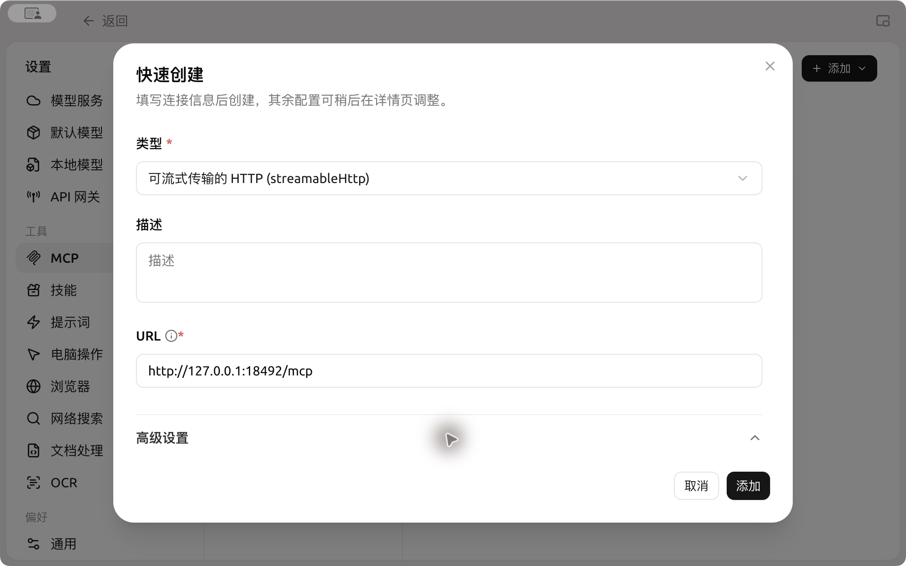
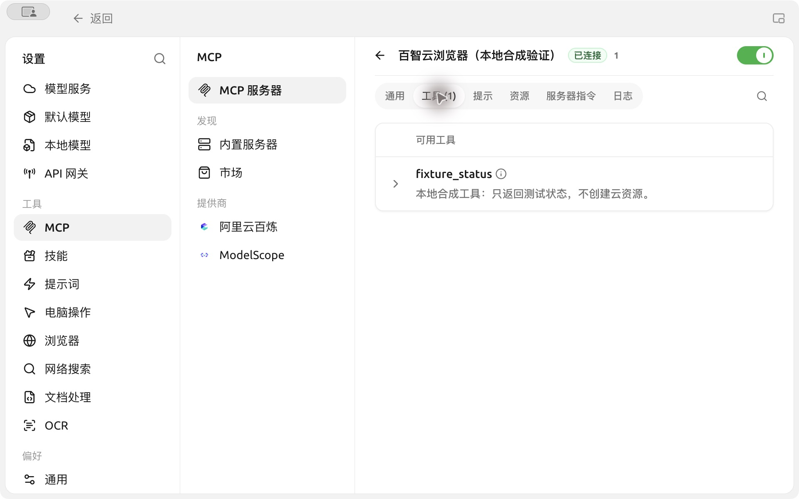
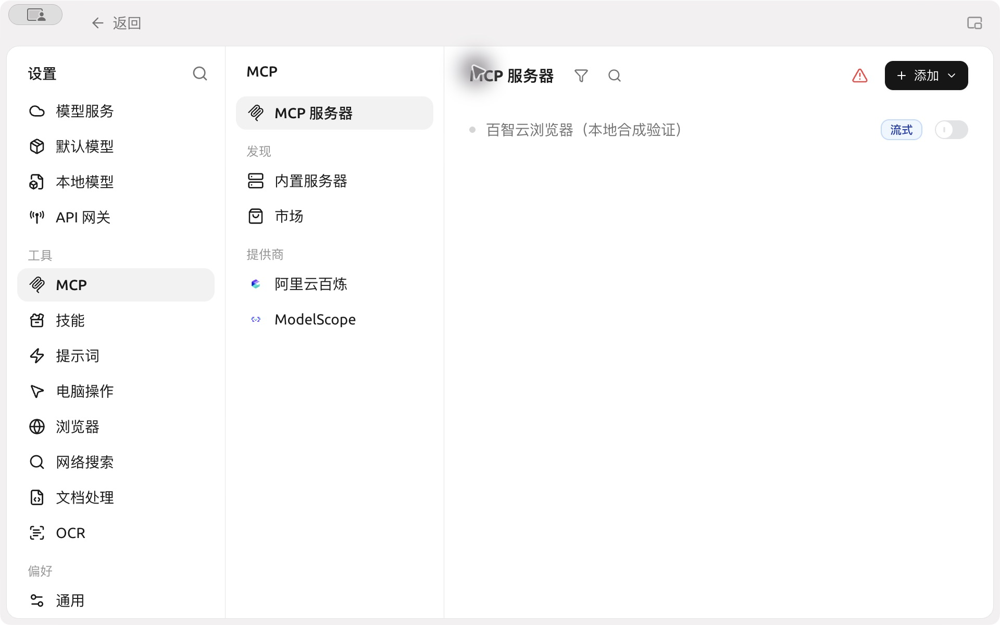
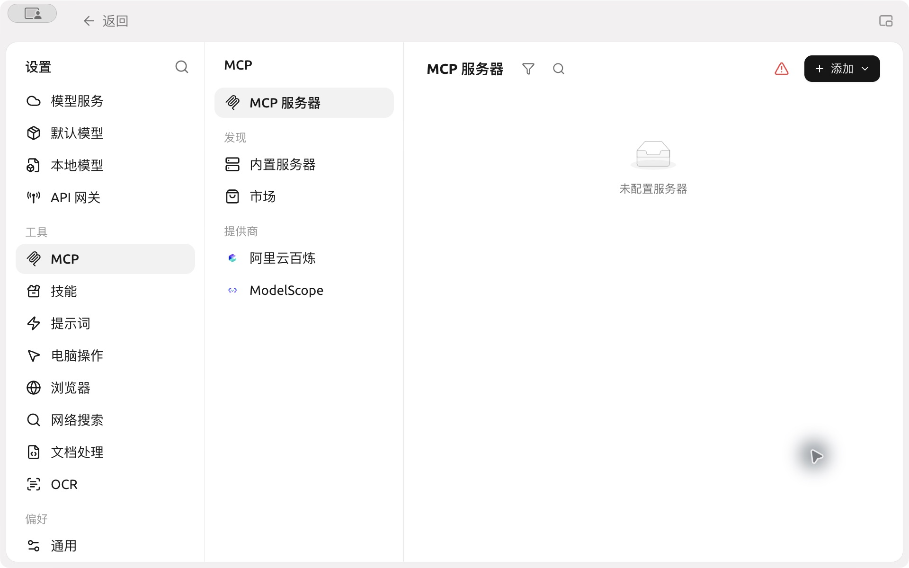

#  SuperAgent 

[](https://baizhibrowser.cloud/zh/)Baizhi Cloud Browser CapyBrowser MCP  CDP 

[](https://capybrowser.app.baizhi.cloud/docs/installation.md) Key  Baizhi Cloud Agent Toolkit  Toolkit  Key 


 SuperAgent MCP 


## 



### 1. 

 MCP  CherryINMCP

→MCP→MCP →“” HTTP (streamableHttp)URL 

```text
https://capybrowser.app.baizhi.cloud/mcp
```


### 2. 


```text
Authorization=Bearer < Key>
```

 `Authorization=Bearer``Bearer`  Key `< Key>`  Key `Bearer`  Key  `example-browser-key`

```text
Authorization=Bearer example-browser-key
```

 Key Key 



 Key


### 3. 

Key 

→→→MCP



`fixture_status` 


### 4. 





##  Key 

 Key  Key 

[](https://capybrowser.app.baizhi.cloud/)[](https://capybrowser.app.baizhi.cloud/docs/installation.md)

<details>
<summary></summary>







</details>

 `ctcbyzx` 
