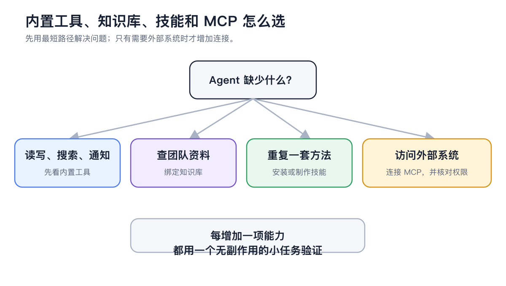
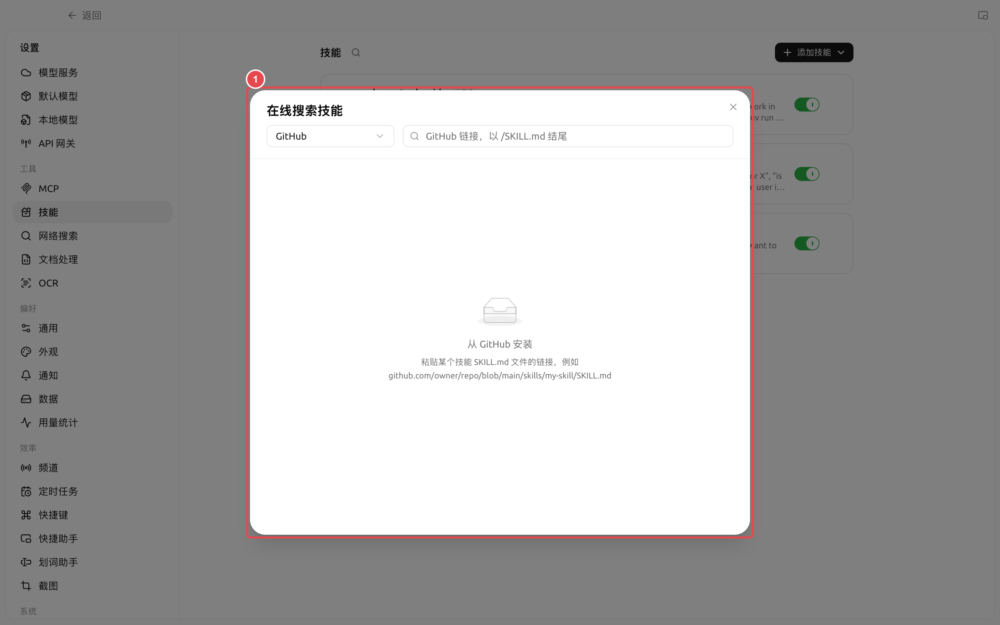
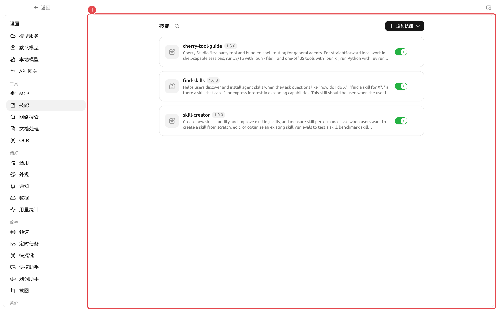

# 


→


<figure><figcaption>

</figcaption></figure>

### 

→

* 
* GitHub `SKILL.md` 
*  ZIP 
*  `SKILL.md` 

<figure><figcaption>
① GitHub `SKILL.md` 
</figcaption></figure>



#### 1. 

“”



#### 2. 





#### 3. 

→→ →→



#### 4. 




### 

<figure><figcaption>
① 
</figcaption></figure>

|  |  |  |
| -------- | ------------------------ | ------------------------- |
|  |  |  |
|  |  |  |
|  |  |  |

<figure><figcaption></figcaption></figure>

### 

- → SuperAgent  `~/.agents/skills`
- 
- 
- 

###  MCP 

|  |  |  |
| -------------- | ----------- | ------------- |
|  |  |  |
|  |  |  |
|  |  |  |
|  | MCP |  |

### 

“” MCP





