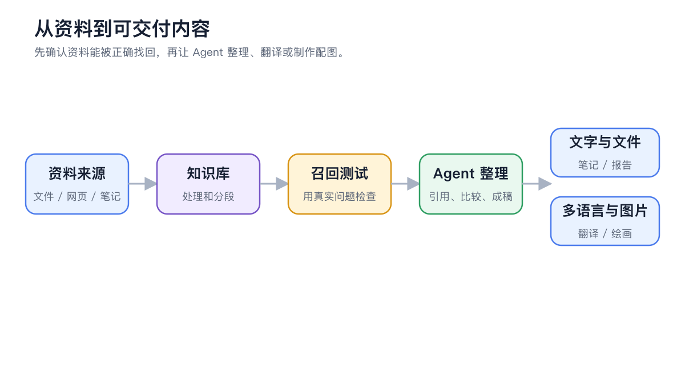
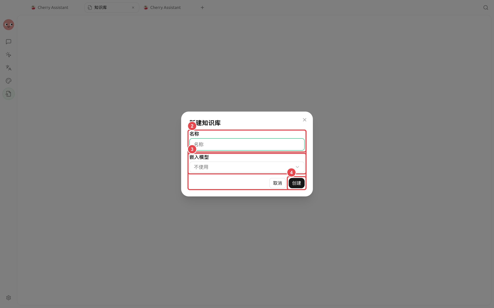

# 

<figure><figcaption>

</figcaption></figure>

## 

|  |  |  |
| ----- | ---------------------- | -------------- |
|  |  |  |
|  |  Markdown  |  |
|  |  |  |
|  |  |  |


“”


<figure><figcaption>

</figcaption></figure>

## 



### 1. 




### 2. 




### 3. 




<table data-view="cards"><thead><tr><th></th><th></th><th data-hidden data-card-target data-type="content-ref"></th></tr></thead><tbody><tr><td><strong></strong></td><td></td><td><a href="knowledge-base.md">knowledge-base.md</a></td></tr><tr><td><strong></strong></td><td></td><td><a href="notes-knowledge-agent.md">notes-knowledge-agent.md</a></td></tr><tr><td><strong></strong></td><td></td><td><a href="painting-workflow.md">painting-workflow.md</a></td></tr><tr><td><strong></strong></td><td></td><td><a href="translation-workflow.md">translation-workflow.md</a></td></tr></tbody></table>
