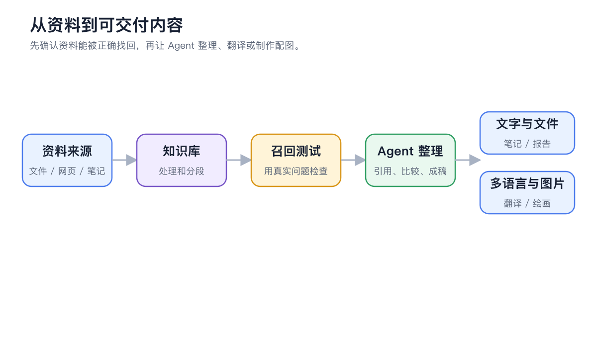
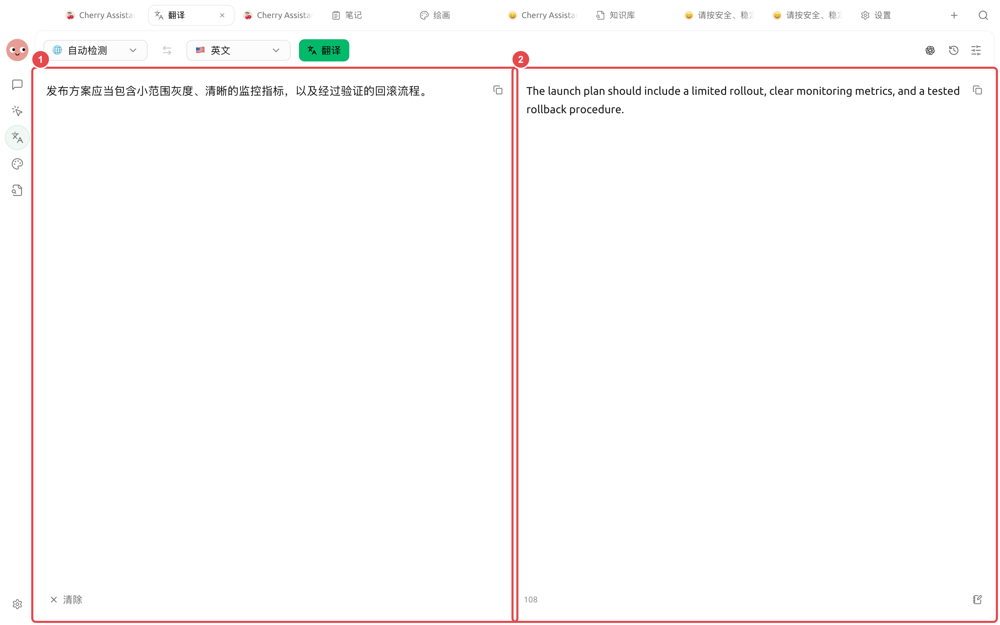

# 

<figure><figcaption>

</figcaption></figure>

### 

|  |  |  |
| -------- | -------------------- | ---------------- |
|  |  |  |
|  |  OCR |  |
| PDF |  BabelDOC |  |
|  |  |  |
| Markdown |  |  |

#### 

“”“”“”

<figure><figcaption>
① ② 
</figcaption></figure>

#### 

|  |  |
| ----- | ------------------ |
|  | “” |
|  |  |
|  |  |
|  |  |

###  PDF

 PDF  BabelDOC BabelDOC PDF



#### 1.  PDF 

/ PDF BabelDOC SuperAgent 



#### 2. 

PDF  API → BabelDOC



#### 3. 

 PDF



#### 4. 

PDF 




 PDF  OCR 


### 



#### 1. 




#### 2. 




#### 3. 

 OCR 



#### 4. 

PDF 



#### 

 OCR 




