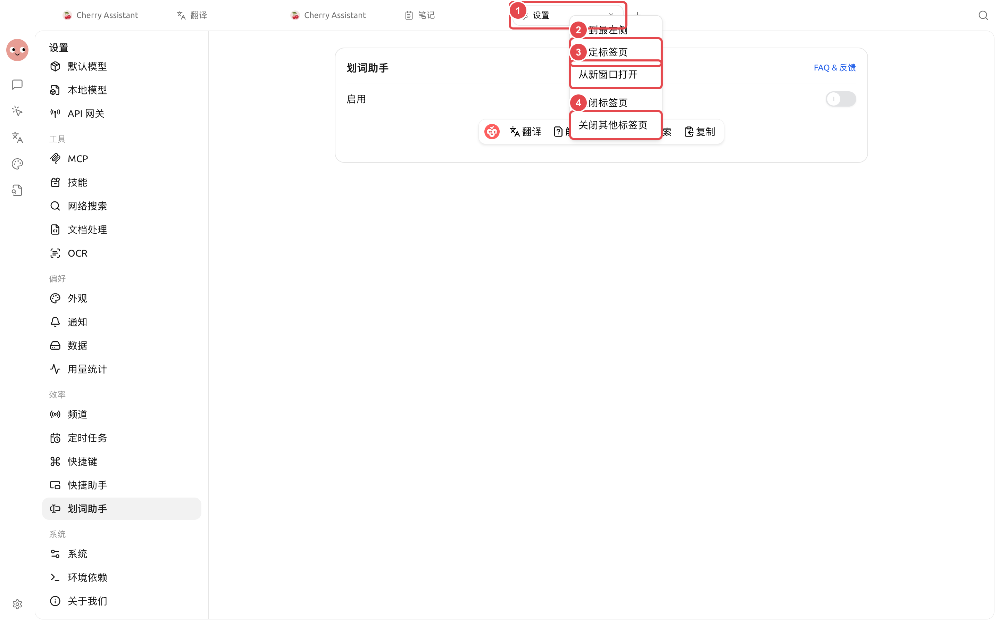

# 

SuperAgent 

<figure><figcaption>

</figcaption></figure>

### 

* 
* 
* 
* 

### 

|  |  |  |
| ------ | -------------------- | -------------- |
|  | → |  |
|  | → |  |
|  | → |  |
|  |  |  |
|  |  |  |
|  | +→ |  |

### 

“”


 SuperAgent 


### 

<table data-view="cards"><thead><tr><th></th><th></th><th data-hidden data-card-target data-type="content-ref"></th></tr></thead><tbody><tr><td><strong></strong></td><td></td><td><a href="multi-window-tabs.md">multi-window-tabs.md</a></td></tr><tr><td><strong></strong></td><td></td><td><a href="composer-efficiency.md">composer-efficiency.md</a></td></tr></tbody></table>
