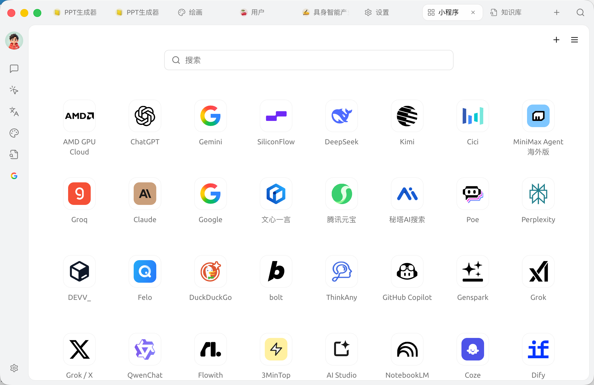
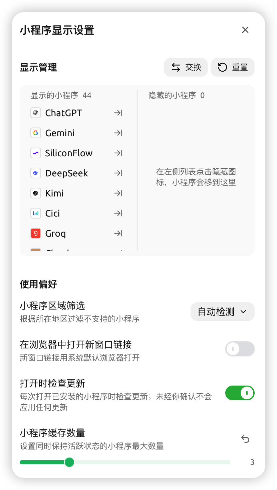
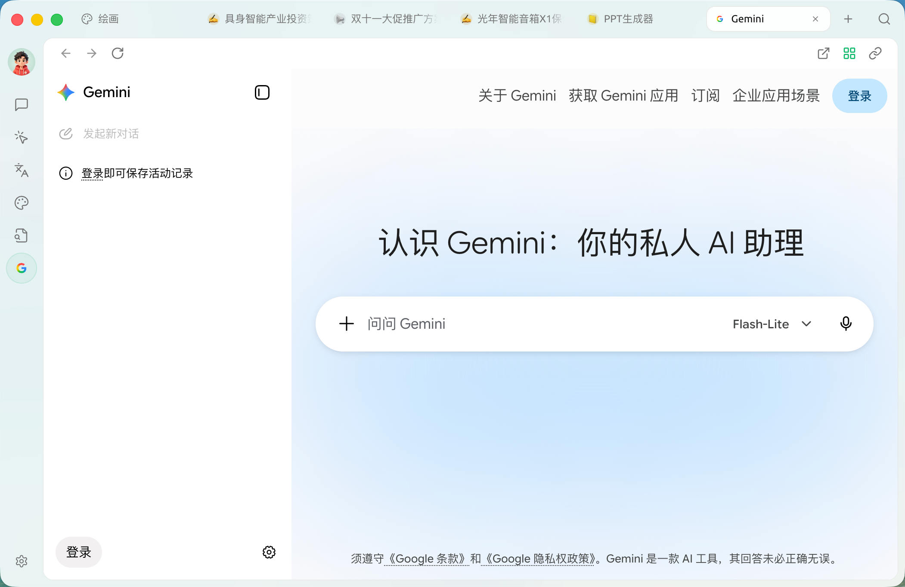

# 

 SuperAgent  AI  SuperAgent  AI 

### 

|  |  |  Cherry AI |  |
| ----- | ---------------------------- | -------------- | ----------------------------------- |
|  | URL  Logo |  |  SuperAgent |
|  |  `.miniapp`  |  |  AI  |


“ Cherry AI ” URL  


### 



### 

 Tab  `+`



### 




### 




<figure><figcaption>
 <code>+</code> 
</figcaption></figure>

 **** `+` `☰` 

### 

 `☰` 

<figure><figcaption>
 / 
</figcaption></figure>

****

* ** / **
* ** / ****** **** 

****

* **** ``
* ****
* ****
* ****

### 

SuperAgent 

* **** `+`  ****
* **** ****  ****
* **Keep Alive**
* **** `+`URLLogo
* **** `+` `.miniapp` 
* ****AI 
* ** / **

****************

<figure><figcaption>
 /  / 
</figcaption></figure>

### 

* Cookie
* 
*  →  

<table data-view="cards"><thead><tr><th></th><th></th><th data-hidden data-card-target data-type="content-ref"></th></tr></thead><tbody><tr><td><strong></strong></td><td> Cherry AI </td><td><a href="generative-mini-apps.md">generative-mini-apps.md</a></td></tr></tbody></table>

  

***

### 

Bug   
