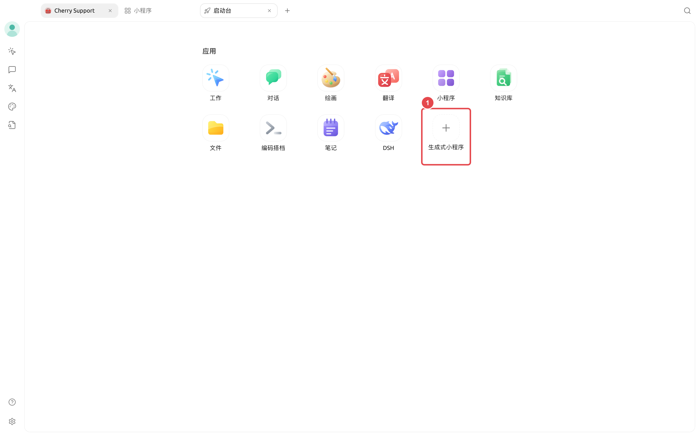
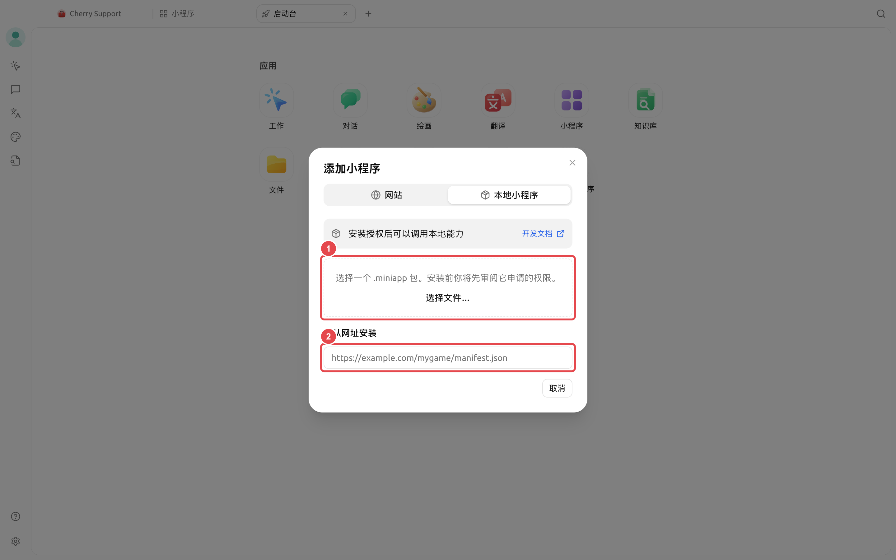
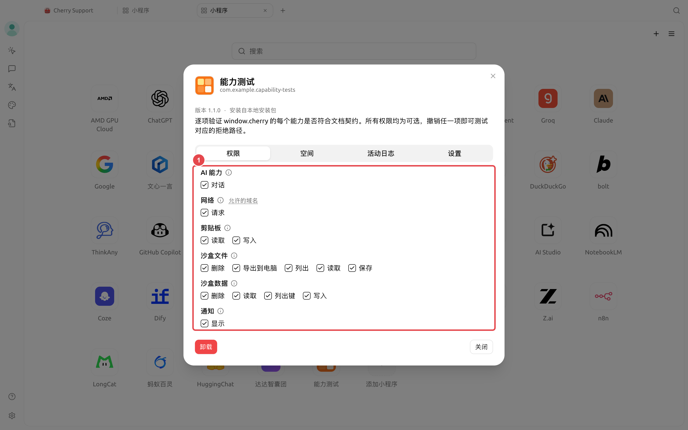
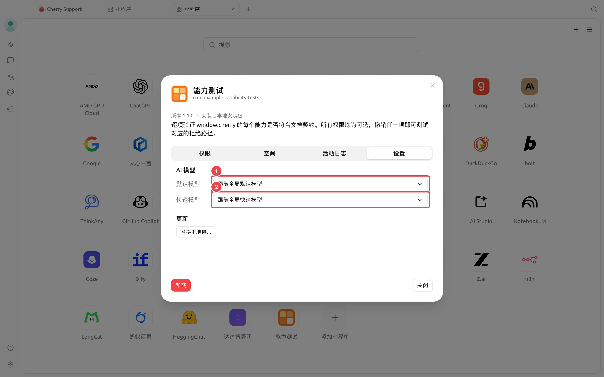

# 

 SuperAgent Web  `window.cherry`  SuperAgent  AI 

 URL `.miniapp` Cherry  AI


SuperAgent  AI  AI  HTMLCSS  JavaScript


## 


* 
*  `.miniapp` 
*  SuperAgent 
* 

 `.miniapp`  ZIP  AI  SuperAgent 

## 

|  |  |  |
| ------ | ------------- | ----------------------------------------- |
|  |  |  SuperAgent AI  |
|  |  |  `.miniapp`  |
|  |  |  URL  `window.cherry`  |
|  |  |  |
|  |  |  API Key |

## 

`→→→→→`

`→→→`

`→→`

## 

### 



### 





### 

 `.miniapp` … HTTPS 



### 


 AI AI →



### 





###  AI 

1. 
2. AI 
3.  SuperAgent 
4.  AI  AI 


### 


```
my-writer/
├── manifest.json
└── index.html
```

 `manifest.json` `ai.chat` 

```json
{
  "id": "com.example.my-writer",
  "name": { "zh": "", "en": "Rewrite Helper" },
  "description": " SuperAgent  AI ",
  "version": "1.0.0",
  "entry": "index.html",
  "permissions": ["ai.chat"]
}
```

`id` `com.superagent.*` 

 `index.html`  `cherry`  AI

```html
<!doctype html>
<html lang="zh-CN">
  <head>
    <meta charset="UTF-8" />
    <meta name="viewport" content="width=device-width, initial-scale=1" />
    <link rel="stylesheet" href="/__cherry/theme.css" />
    <title></title>
  </head>
  <body>
    <textarea id="source" placeholder=""></textarea>
    <button id="rewrite"></button>
    <pre id="result"></pre>

    <script>
      const button = document.querySelector('#rewrite')
      const source = document.querySelector('#source')
      const result = document.querySelector('#result')

      button.addEventListener('click', async () => {
        const capability = await cherry.ai.getCapabilities({ model: 'default' })
        if (!capability.available) {
          result.textContent = ''
          return
        }

        result.textContent = ''
        await cherry.ai.chat(
          {
            model: 'default',
            reasoning: 'off',
            messages: [
              { role: 'system', content: '' },
              { role: 'user', content: source.value }
            ]
          },
          {
            callId: `rewrite-${Date.now()}`,
            onChunk: (text) => {
              result.textContent += text
            }
          }
        )
      })
    </script>
  </body>
</html>
```

`window.cherry`  `cherry`  SDK `default`  `quick`  API Key

### 

1.  `manifest.json`  `entry` 
2. macOS  Linux 

```bash
zip -r ../my-writer.miniapp . -x '.*' -x '__MACOSX/*'
```

Windows PowerShell  ZIP `.miniapp` 

```powershell
Compress-Archive -Path .\* -DestinationPath ..\my-writer.zip
Rename-Item ..\my-writer.zip my-writer.miniapp
```

3.  SuperAgent  `my-writer.miniapp`
4. AI 
5. 


 `manifest.json`SuperAgent 


## 

AI 

 AI →AI →

## 

<figure><figcaption><p></p></figcaption></figure>

1. 

<figure><figcaption><p></p></figcaption></figure>

1.  `.miniapp` …
2.  HTTPS 

<figure><figcaption><p></p></figcaption></figure>

1. AI 

<figure><figcaption><p> AI </p></figcaption></figure>

1.  AI 
2. 





## 

|  |  |  |  |  |  |
| ----- | --------------------- | ------------------------ | ----------------------- | -------------- | ----------------------- |
|  | — |  `.miniapp`  |  HTTPS  |  |  |
| AI  |  |  |  `cherry.ai.chat()` |  AI  |  |
|  |  |  |  |  |  |
|  |  |  |  |  |  `quick`  |
|  |  |  |  |  |  |
|  |  SuperAgent  |  `/__cherry/theme.css` |  |  |  CDN  |

### 

|  |  |  |
| --------------------- | ----------------------- | ---------------------------------- |
| `cherry.storage` |  | `storage.*`  |
| `cherry.file` |  | `file.*`  |
| `cherry.notification` |  SuperAgent  | `notification.show` |
| `cherry.network` |  HTTPS  | `network.fetch` `network`  |
| `cherry.clipboard` |  | `clipboard.read``clipboard.write` |
| `cherry.app` |  |  |

 `localStorage` `fetch`Cookie CDN `cherry.storage` `cherry.network.fetch` 

## 

|  |  |  |  |
| ------- | ----------- | ------------------------- | -------------- |
|  |  |  |  |
|  |  |  |  |
|  |  |  |  |
|  |  |  |  |
|  |  |  |  |
|  |  | AI  |  |





## 

<details>

<summary> URL Cherry AI</summary>

 `window.cherry` `.miniapp` 

</details>

<details>

<summary> API Key </summary>

SuperAgent  API Key 

</details>

<details>

<summary> AI </summary>

→AI →

</details>

<details>

<summary></summary>

→ AI

</details>

<details>

<summary></summary>


</details>

## 

* [SuperAgent MiniApps ](https://github.com/DrOlu/SuperAgent-miniapps/blob/main/README.zh-CN.md)
* [MiniApp ](https://github.com/DrOlu/SuperAgent/tree/main/docs/references/mini-app)
* [](https://github.com/DrOlu/SuperAgent/blob/main/docs/references/mini-app/manifest.md)
* [](https://github.com/DrOlu/SuperAgent/blob/main/docs/references/mini-app/capabilities.md)
* [](https://github.com/DrOlu/SuperAgent/blob/main/docs/references/mini-app/packaging.md)
