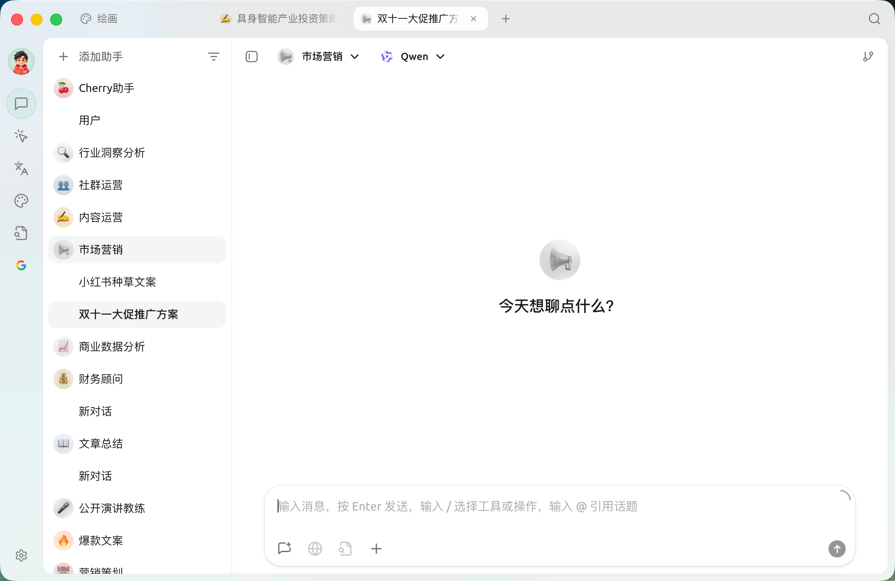
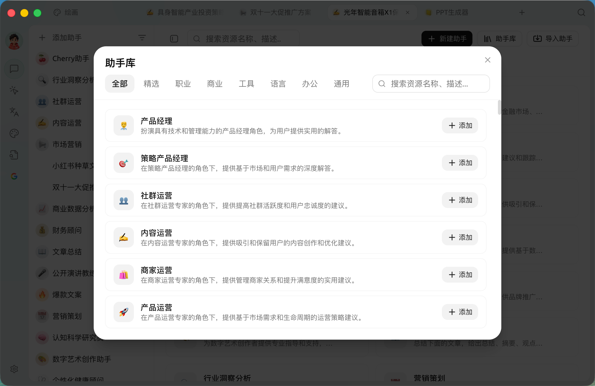
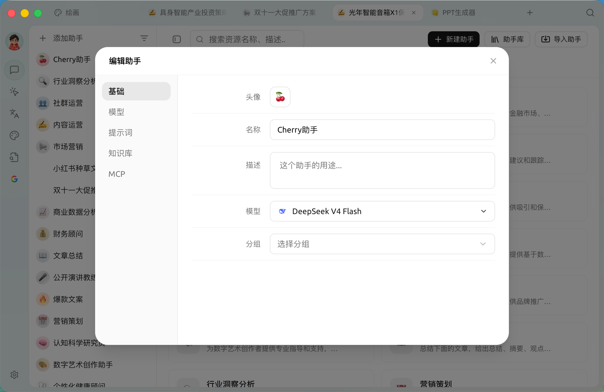
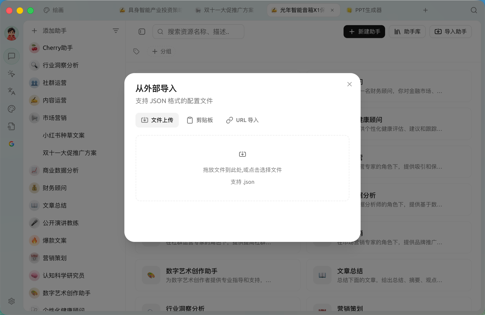
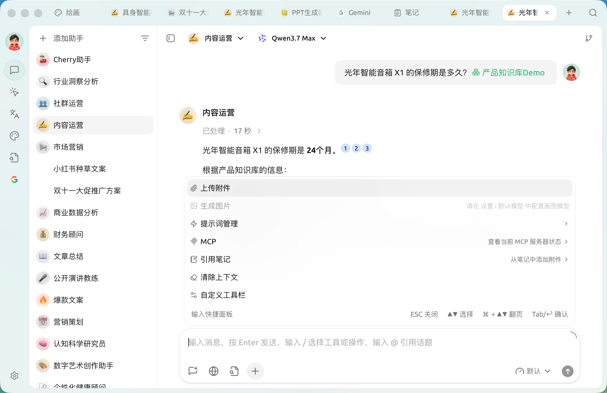
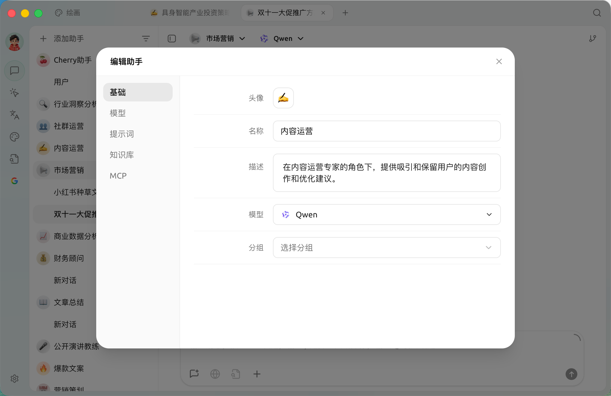

# -

 SuperAgent  **** → 


    


## 

* ** = **""" reviewer"
* ** = **"""bug "

**** AI 

### 

 AI  ——  + 

* ****
* ****  

### 

* """ A "" B bug"
* ""

<figure><figcaption>

</figcaption></figure>

## 

 ****  ****" +  + "


**** →


### 

1.  **** 
2. 

<figure><figcaption>
 —— 
</figcaption></figure>

### 

* **** `` / ``  
* ****
* ****

### 

*  **** 
* 

### 

  

* ****
* ****Top-P Token  
* ****AI   
* **** 
* **MCP** MCP 

<figure><figcaption>
 /   /  /  /  / MCP 
</figcaption></figure>


**** ****  


### 

* ****  
* ****
* ****
* **** JSON 

 `assistants.json` 5 MiB

* **** JSON 
* **** JSON 
* **URL ** JSON  GitHub Gistraw.githubusercontent.com 

<figure><figcaption>
 ——  /  / URL 
</figcaption></figure>

### 

|  |  |
| ------------------------ | ---------------------------------------------------------------------------------------------------------------------------------------- |
| "" | **** |
|  AI  | [****](../../advanced-basic/agent.md) |
|  | ** +** [****](../../advanced-basic/automation/scheduled-heartbeat.md) **+** [****](../../advanced-basic/automation/channels.md) |

## 

<figure><figcaption>
 4 +
</figcaption></figure>

 ** 4 ** **+** +→

### 

|  |  |
| ------------- | ----------------------------------------------------------- |
| **** |  |
| **** |    |
| **** |    |
| **+** |  |

### +

 **+** `/` <kbd>↑↓</kbd> <kbd>Tab</kbd> / <kbd></kbd> <kbd>ESC</kbd> 

|  |  |
| ---------- | --------------------------------------------------------------------------------- |
| **** |  |
| **** | →  |
| **** |   |
| **MCP** |  MCP  |
| **** |    |
| **** | ****"" |
| **** |  |

 <kbd>Enter</kbd> / <kbd>Space</kbd>


**""**


### 

* ** / **
* ****
* **** <kbd>Enter</kbd>  

### 

* **`/`** **+** 
* **`@`**


→→ ** Token **  Token 


## 

 ****  ****  ` → ` **** 

### 

 ` → `  

* **** /  /  / 
* **** Token Markdown 

### 

Top-P Token  ****   

## 

 **** 

### 





* ****
* ****Top-P Token 
* **** prompt  
* **** 
* **MCP** MCP 

<figure><figcaption>

</figcaption></figure>

#### 

 


 = 


#### 

#### <mark style="color:blue;">**` (Temperature)`**</mark> 

 0.7

* (0-0.3)
  * 
  * 
  * 
* (0.4-0.7)
  * 
  * 
  * (0.5 )
* (0.8-1.0)
  * 
  * 
  * 

#### <mark style="color:blue;">**`Top P ()`**</mark>

 1AI AI 

* (0.1-0.3)
  * 
  * 
  * 
* (0.4-0.6)
  * 
  * 
* (0.7-1.0)
  * 
  * 
  * 


- 
- 
- 
- 


#### <mark style="color:blue;">**``**</mark>

 token 

#### <mark style="color:blue;">**``**</mark>

 100  1–1000  20 

“” Token

#### <mark style="color:blue;">**` (MaxToken)`**</mark>

 [Token](https://docs.superagent.ng/question-contact/knowledge#shen-me-shi-tokens) max token

> : SuperAgent  key , MaxToken  1 

 MaxToken  32k Tokens 64k



* 500-800
* 800-2000
* 2000-3600
* 4000  ()



 MaxToken 


#### <mark style="color:blue;">**`Stream`**</mark>

 SuperAgent 

()


 ****  o1-mini 


#### <mark style="color:blue;">**``**</mark>

body `presence_penalty` 

>  top-pmaxtokensstream 

——






* 

>  `model`  `gpt-4o`  `gpt-4o` 

*  <kbd>:undefined</kbd> 


***

### 

Bug   
