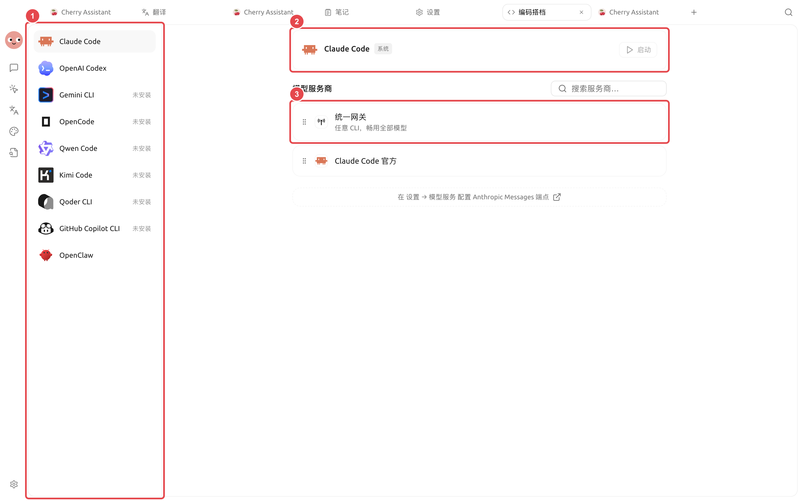

# 

SuperAgent  CLI

<figure><figcaption>

</figcaption></figure>

## 

* 
*  SuperAgent 
*  PATH 
*  CLI 
*  CLI 
* 

 Claude CodeOpenAI CodexGemini CLIOpenCodeQwen CodeKimi CodeQoder CLI  GitHub Copilot CLI 

## 



### 1. 

 SuperAgent 



### 2. 

 CLI SuperAgent 



### 3. 

 SuperAgent  CLI 



### 4. 

 CLI 



### 5. 




## Claude Code 

 Claude Code 

* 
*  FableOpusSonnetHaiku  Subagent1M

## 

|  |  |  |  |
| ----- | ----------------------------- | ------------ | ---------------- |
|  |  |  CLI |  |
|  |  SuperAgent  |  CLI |  |
|  |  |  |  |
|  |  |  |  |

### 

## 

|  | SuperAgent  |  |
| ---------------- | ------------------ | ------------------ |
| SuperAgent  |  |  |
|  PATH |  |  |
|  |  |  SuperAgent  |


 SuperAgent 


 CLI

SuperAgent 

