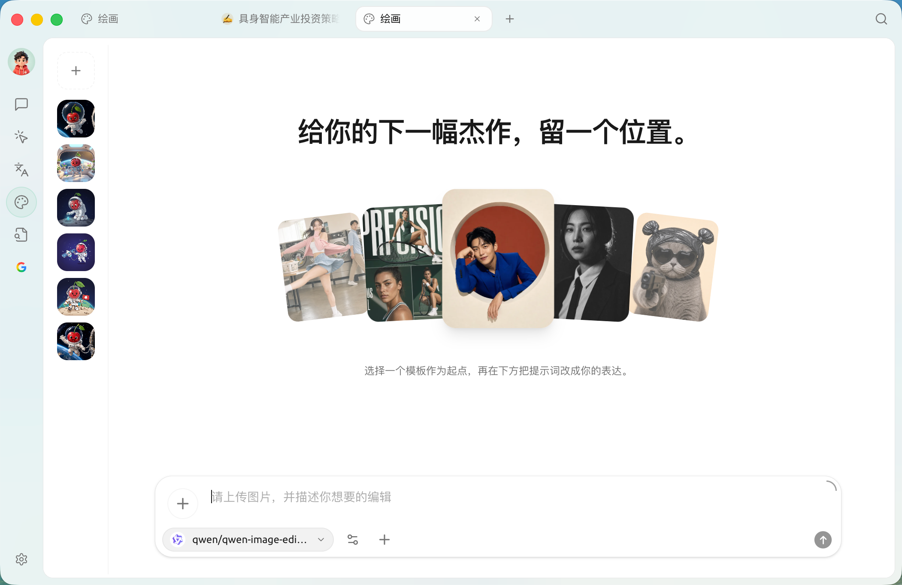
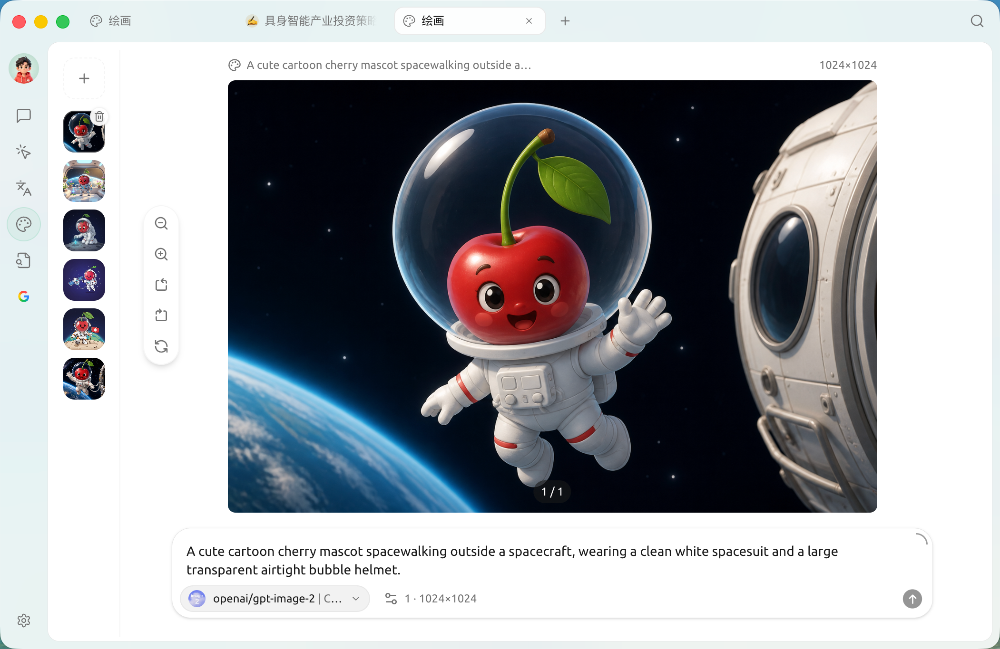
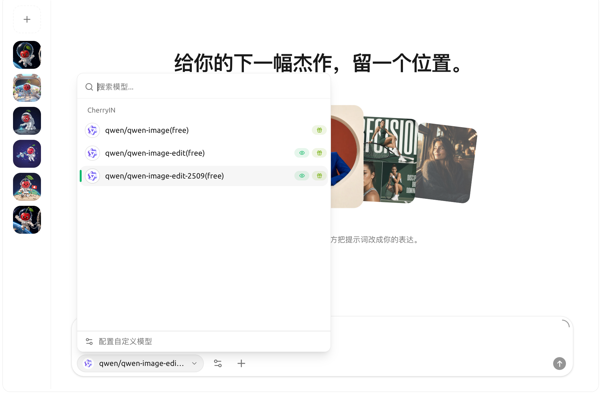
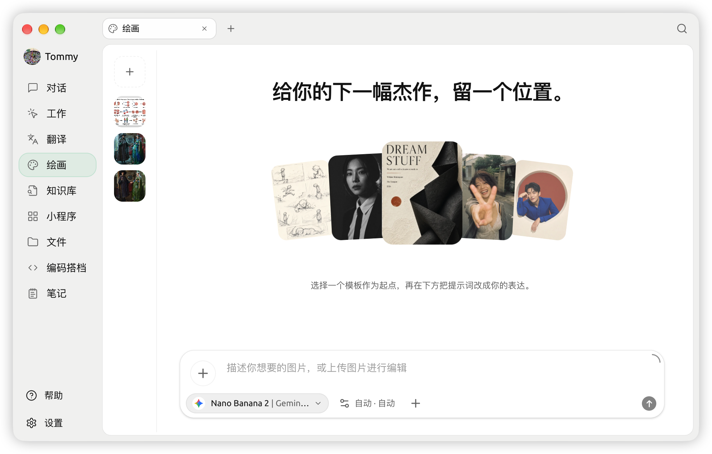

# 

 SuperAgent  **** Midjourney / DALL·E ** SuperAgent **

## 

 **+** 

<figure><figcaption><p></p></figcaption></figure>


* **** `+` 
* ****
* **** ****  `` 
* ** / ******—— `qwen-image` `qwen-image-edit`

 **** `qwen-image-edit`“ + ”

<figure><figcaption><p> —— </p></figcaption></figure>

## 

SuperAgent  ****

<figure><figcaption><p>“”</p></figcaption></figure>


|  |  |  |
|---|---|---|
|  | **[](../../pre-basic/providers/siliconcloud.md)** |  |
| | **[PPIO ](../../pre-basic/providers/ppio.md)** |  |
| | **** |  CogView |
|  | **AiHubMix** |  |
| | **DMXAPI** |  |
| | **TokenFlux** |  |
| | **CherryIN** | Cherry  |
| | ** AIAiOnly** |  |
|  /  | **New API** |  |
| | **OVMS** | OpenVINO Model Server OVMS  |


 ** ` (OpenAI)`** 


## 

1.  ****"" ``  ** (OpenAI)** 
2.  **** `qwen-image` ****/
   ```
   
   ```
3. 
4.  ****
5. 


→→ ****""


## 

 **ⓘ ** / Aihubmix / PPIO  ****  Tooltip——NewAPI 


* **** 1024x1024 
* **Steps**""20-30 
* **CFG / Guidance**AI ""7-12 
* **Seed**

## 

* ****
* 
* "" **img2img**
*  4  4 "" 4






Gemini  Gemini  **Nano Banana 2**


<figure><figcaption><p> Gemini  Nano Banana 2</p></figcaption></figure>

***

### 

Bug  [](../../question-contact/suggestions.md) 
