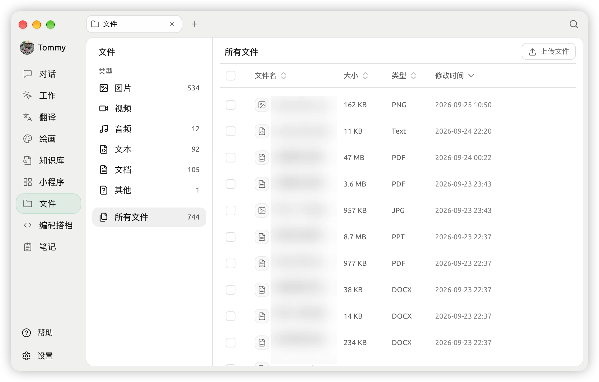
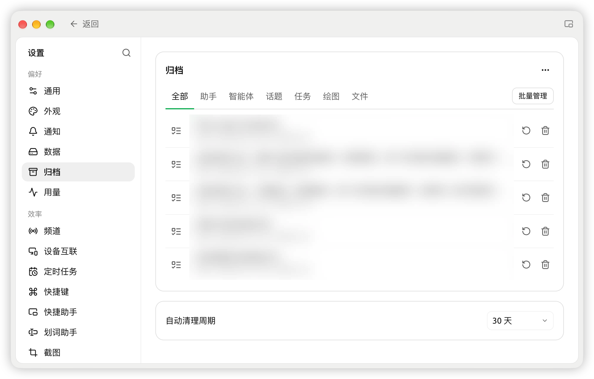

# 

 SuperAgent  **** —— PDF

 SuperAgent ""

## 

 Tab  `+` →→ 

<figure><figcaption><p></p></figcaption></figure>

## 

* **** —— ``````````````
* **** `` / `` / `` / `` 
* ****
* **** ``
* ****PDF 
* **** → 
* **** →  **** **** 
* **** →macOS = Windows = 


 ****


## 

 **→** **** 

****************************

* ****
* ****

 ****  **** 30 

<figure><figcaption><p> → </p></figcaption></figure>


**** 


## 

SuperAgent 

* **macOS**`~/Library/Application Support/SuperAgent`
* **Windows**`%APPDATA%\SuperAgent`
* **Linux**`~/.config/SuperAgent`

 [](../../pre-basic/personalization-settings/storage.md)

## 

*  / 
* WebDAV / S3  [](../../pre-basic/data-settings/)
* 

***

### 

Bug  [](../../question-contact/suggestions.md) 
