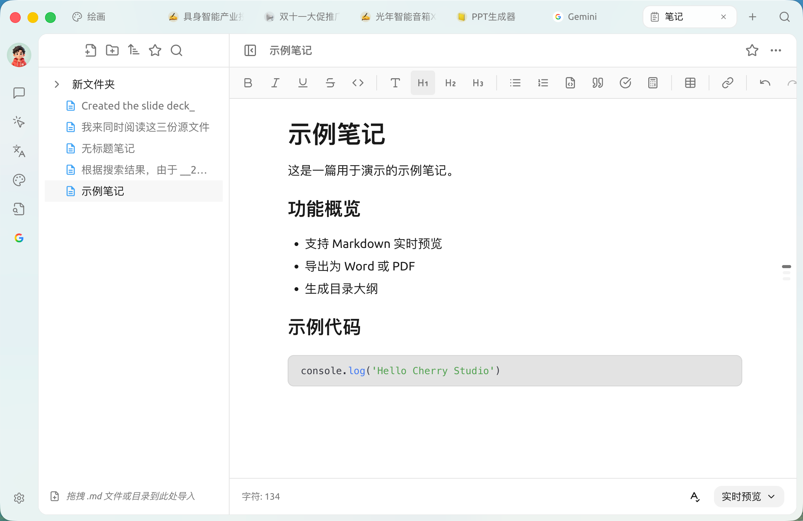
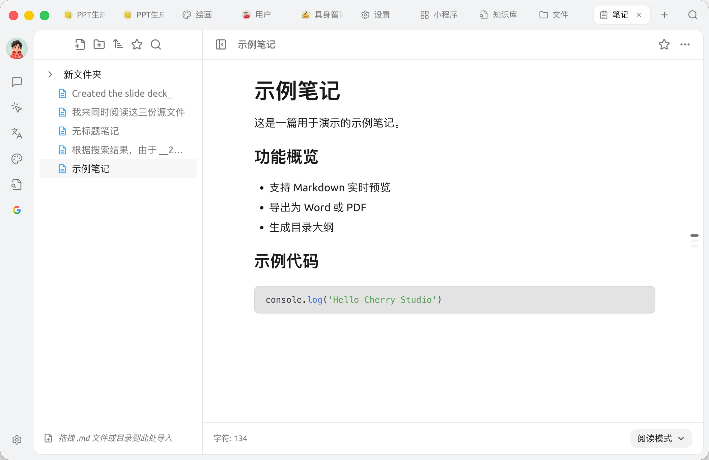
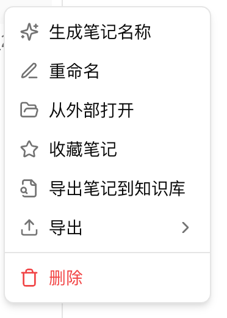
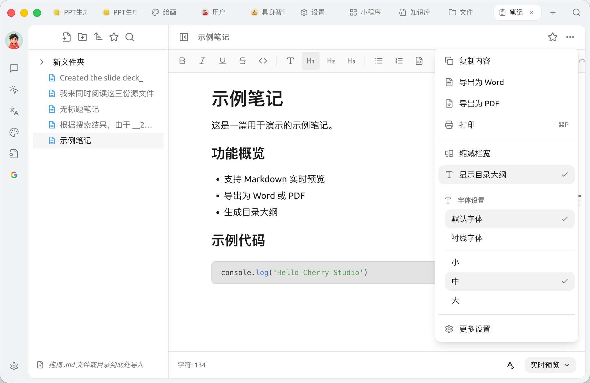

# 

 SuperAgent  Markdown  AI  AI 

### 

<figure><figcaption>
 Markdown 
</figcaption></figure>

### 

1. 
2.  Markdown 
3. 

###  Markdown 

*  `.md`  `.md`  **** 
* 

### 

* ****<kbd>B</kbd><kbd>I</kbd><kbd>U</kbd>
* **** / H1–H3  /  /  /  /  /  / 
* ****

<figure><figcaption>

</figcaption></figure>

 **** **A✓**  ********  ****

### 

////

* ****6 —— `A→Z` / `Z→A` /  / 
* ****""
* ******** ""  "+" 

### AI  + 

 **** —— AI 

<figure><figcaption>

</figcaption></figure>

* **** ✨ AI 
* **** / **** Finder / 
* **** / ****
* **** 
* ** ›** Markdown / Word.docx/ Notion /  / Obsidian / Joplin / " / "——→→
* ****

>  /  /  /  / 

### ⋯

⋯ ****  / 

<figure><figcaption>
⋯
</figcaption></figure>

* ****
* ** Word** `.docx`" ›"
* ** PDF** PDF 
* ****
* ****
* ****
* ** ›** /  /  / 
* **** /  / 

### 

**** ⋯→

*  SuperAgent 
* 
*  [WebDAV](../../pre-basic/data-settings/webdav.md) / [S3 ](../../pre-basic/data-settings/s3-compatible.md)

### 

⋯→

****

* ****
* ****

****

* **** / 
* ****10–30px 
* ****
* ****

> ⋯→

### 

*  `- [ ]` 
*  `.md`  `.md` 
* 


 AI ****  ****


***

### 

Bug   
