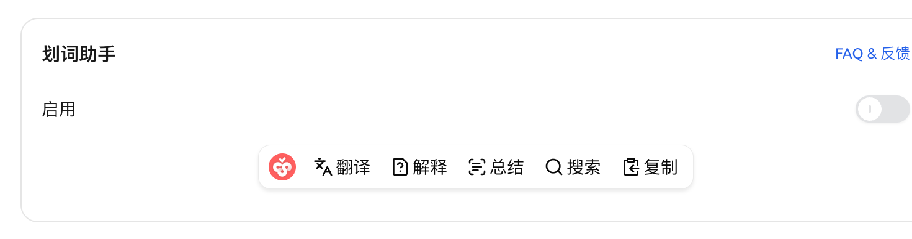
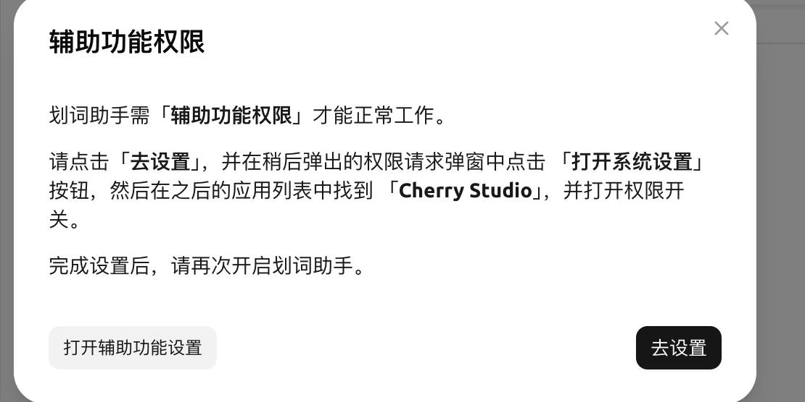
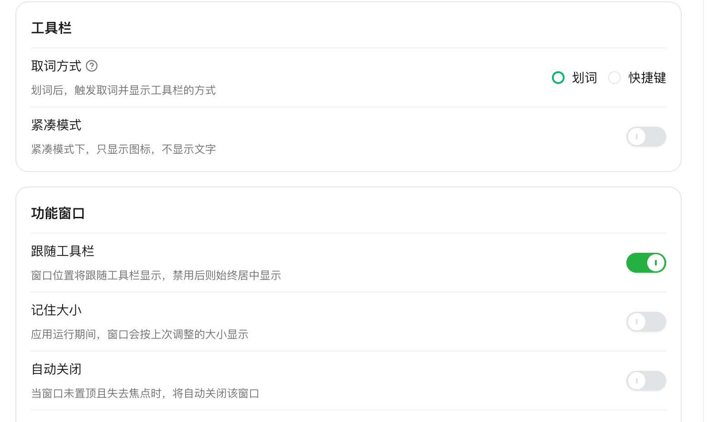
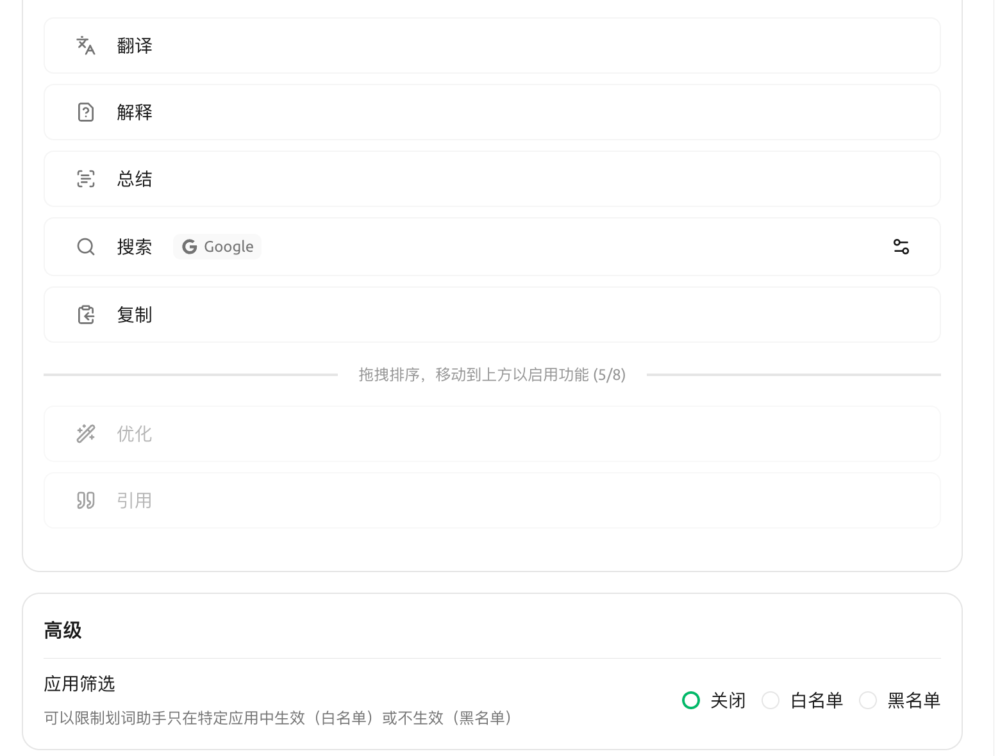

# 

Selection Assistant ****  AI  SuperAgent


**  **

* **** **** 
* **** **** 


### 

* ✅ **macOS** **Accessibility**
* ✅ **Windows**
* ⚠️ **Linux** **X11** Wayland  `input` `sudo usermod -aG input $USER`

### 

→

<figure><figcaption>

</figcaption></figure>

1.  **** 
2. **macOS**  ****

   <figure><figcaption>

</figcaption></figure>

    **** → →→ SuperAgent  →  SuperAgent 
3. →
   * ****
   * **Ctrl ** Windows ** Ctrl ** 
   * ****→

<figure><figcaption>
 /  / …
</figcaption></figure>

### 

 7 ** 5 ** /  /  /  /  **Cherry **——

|  |  |  |
|---|---|---|
| **** | ✅ |  |
| **** | ✅ |  AI  |
| **** | ✅ |  AI  |
| **** | ✅ |  Google ⋯  |
| **** | ✅ |  |
| **** |  |  AI  /  |
| **** |  |  |

<figure><figcaption>

</figcaption></figure>

### 

→→

* **** 
* ****  +  + 
* **** 
* ""

###  / 

* ****

* ****
* ****
* ****
* ****
* ****20%–100% 

### 

GoogleBingDuckDuckGo →→ **** URL  `{{queryString}}` 

### 

→→→ ** / **

* **macOS** Bundle ID `com.google.Chrome``com.apple.mail`
* **Windows** `chrome.exe``SuperAgent.exe`

### 

 

### 

* macOS →→ SuperAgent 
*  **Ctrl ** 
*  ****
* """"  

***

### 

Bug   
