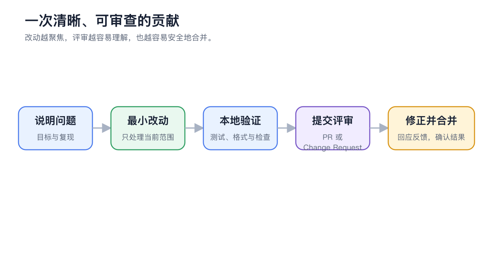

# 

 GitHub Issue  Discussion 

<figure><figcaption>

</figcaption></figure>

## 

<table data-view="cards"><thead><tr><th></th><th></th><th data-hidden data-card-target data-type="content-ref"></th></tr></thead><tbody><tr><td><strong>SuperAgent </strong></td><td>README </td><td><a href="https://github.com/DrOlu/SuperAgent">https://github.com/DrOlu/SuperAgent</a></td></tr><tr><td><strong>GitHub Issues</strong></td><td></td><td><a href="https://github.com/DrOlu/SuperAgent/issues">https://github.com/DrOlu/SuperAgent/issues</a></td></tr><tr><td><strong></strong></td><td></td><td><a href="https://github.com/DrOlu/SuperAgent/blob/main/CONTRIBUTING.md">https://github.com/DrOlu/SuperAgent/blob/main/CONTRIBUTING.md</a></td></tr><tr><td><strong></strong></td><td></td><td><a href="https://github.com/DrOlu/SuperAgent/blob/main/CODE_OF_CONDUCT.md">https://github.com/DrOlu/SuperAgent/blob/main/CODE_OF_CONDUCT.md</a></td></tr></tbody></table>

 `good first issue``help wanted`  `kind/bug`  Issue 

## 

 `main` Issue


 PR  PR 


## 

|  |  |
| ------------ | -------------------------- |
|  |  |
|  |  |
|  |  Issue  Discussion  |
|  |  PR |


 PR 


## 



### 1. Fork 

 PR 



### 2. 

Developer Guide Node.js  pnpm  `pnpm install`



### 3. 




### 4. 

 `git commit --signoff`  DCO 



### 5.  PR

 Release Note Draft PR



## PR 

 PR  `needs-ok-to-test` `/ok-to-test` Draft PR  Ready for review

## 

* 
*  Issue/PR 
* 
* 
* 
*  API Key
* Commit Release Note 

 Issue 

 Issue  Issue 

CI 

 PR  Draft PR  `/ok-to-test` `needs-ok-to-test`  PR 

