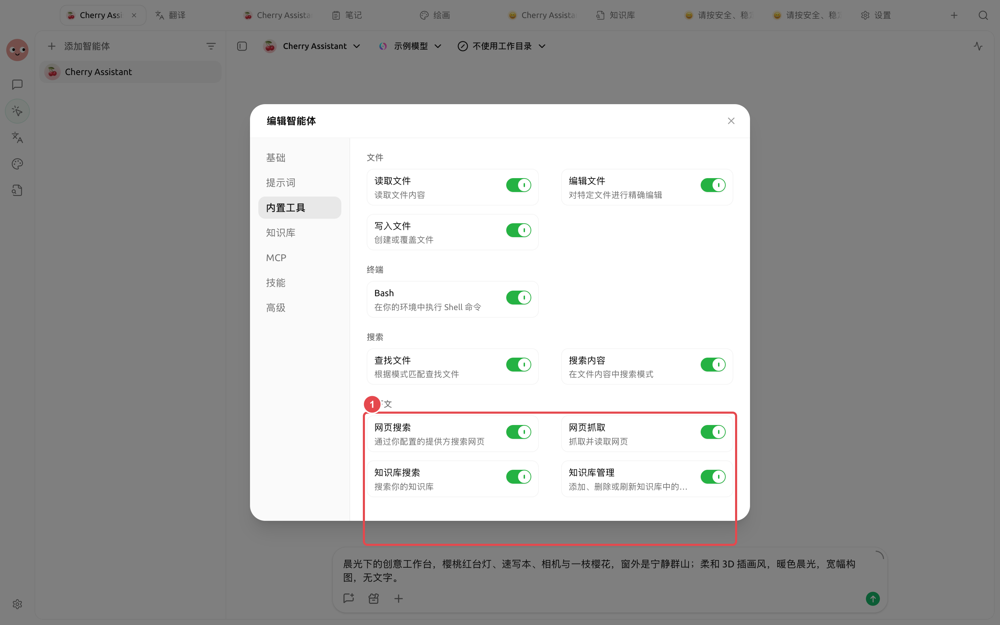
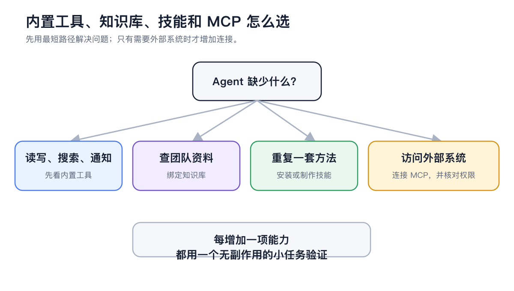
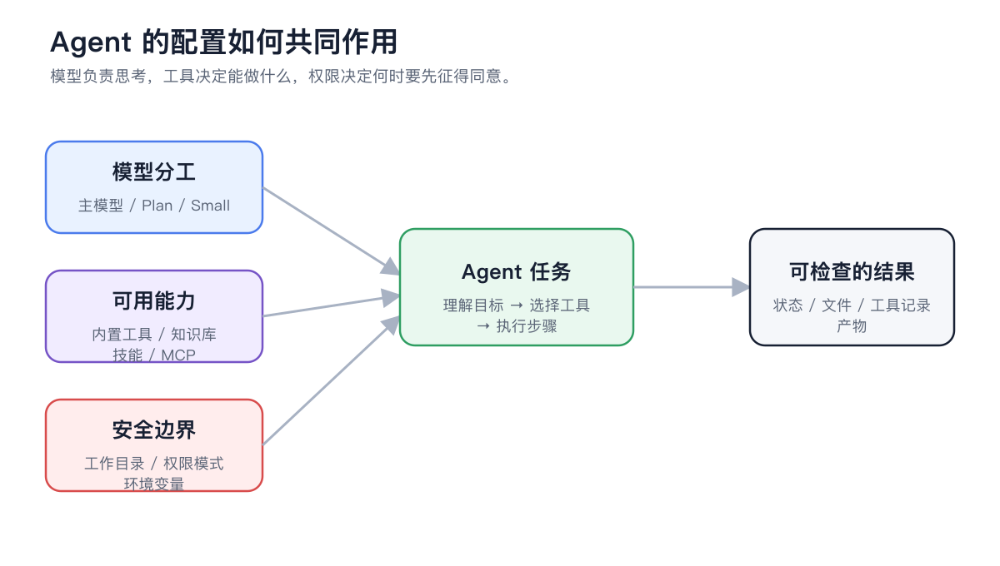

# 





## 

|  |  |
| ------------ | --------------- |
|  |  |
|  |  |
|  |  |
|  |  |

## 



### 1. 





### 2. 




### 3. 




### 4. 

<figure><figcaption>

</figcaption></figure>



### 5. 




### 6. 




##  MCP 

<figure><figcaption>
 MCP
</figcaption></figure>

## 

|  |  |  |  |
| ----- | -------------- | ----------- | ----------- |
|  |  |  |  |
|  |  |  |  |









## 

<figure><figcaption>

</figcaption></figure>

## 

### 

>  Markdown 

### 

>  FAQ

### 

> “”“”“ /  / ”

## 

|  |  |  |  |
| ----- | ---------- | ------------ | ------------- |
|  | 1  |  |  |
|  |  |  |  |
|  |  |  |  |
|  |  |  |  |

## 

## 

* 
* 
* 
* 
* 

## 

## 

<table data-view="cards"><thead><tr><th></th><th></th><th data-hidden data-card-target data-type="content-ref"></th></tr></thead><tbody><tr><td><strong></strong></td><td></td><td><a href="chat.md">chat.md</a></td></tr><tr><td><strong></strong></td><td></td><td><a href="data.md">data.md</a></td></tr><tr><td><strong></strong></td><td></td><td><a href="cases.md">cases.md</a></td></tr></tbody></table>
