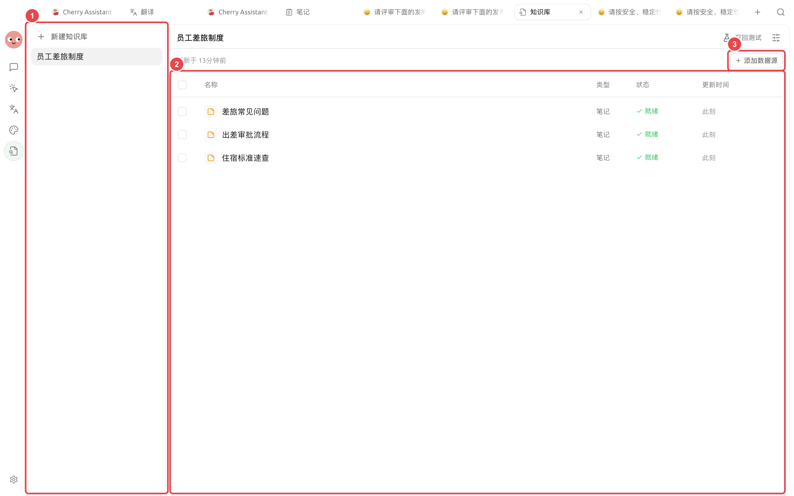
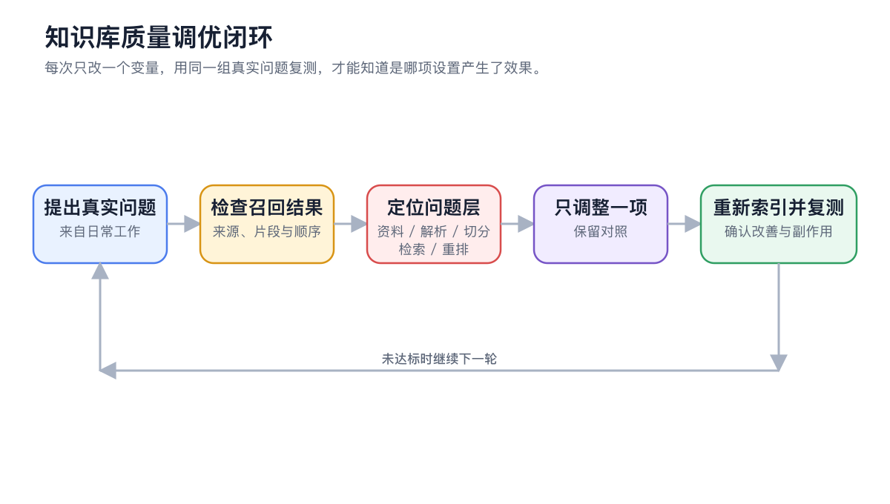
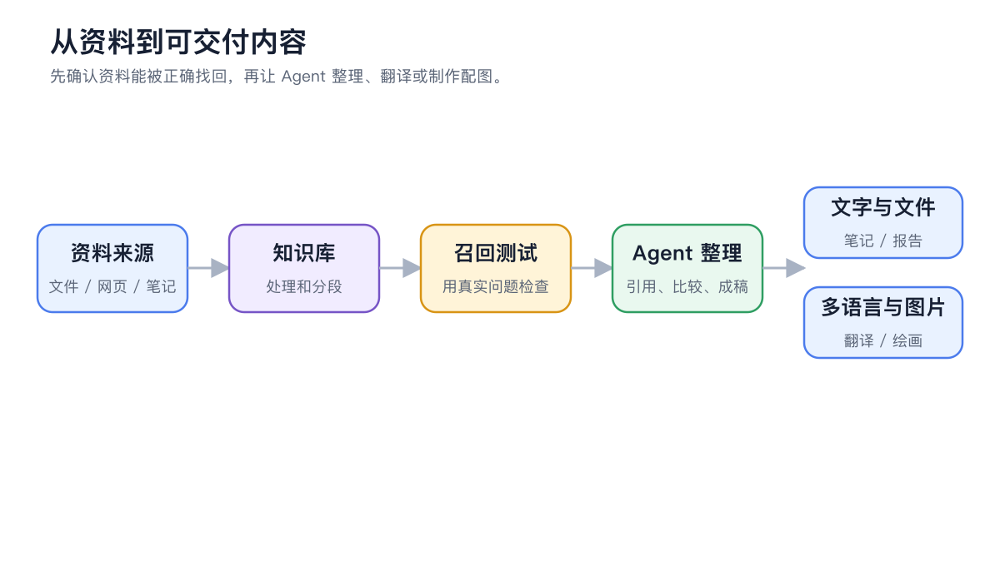

# 


 310 


## 



### 1. 




### 2. 




### 3. 




### 4. 

 310 



### 5. 

BM25 




### 6. 




## 

### 

### 

* 
* 
* 
* 

<figure><figcaption>
 FAQ 
</figcaption></figure>

### 

|  |  |  |
| ---- | ---------- | ----------------- |
|  |  BM25 |  |
|  |  |  |
|  |  |  |
|  |  |  |

### 

1. 
2. 
3.  5000 
4. 

### 

> “”“”





## 

### 

### 

|  |  |  |
| ------- | ------------- | ------------- |
|  |  |  |
|  |  |  |
|  |  |  |

### 

* PDF 
*  BM25
* 
* 

> 

### 

* 
* 
* 
* 

## 

### 

### 

* 
* 
* 
* 

<figure><figcaption>

</figcaption></figure>

### 

> “” Markdown 

### 

<figure><figcaption>

</figcaption></figure>

### 

* 
* 
* 
* 

## 

|  |  |
| ---- | ---------------------- |
|  |  |
|  |  |
|  |  |
|  |  OCR |
|  | BM25  |
|  |  310  |
|  |  |
|  |  |


“”


## 

## 

<table data-view="cards"><thead><tr><th></th><th></th><th data-hidden data-card-target data-type="content-ref"></th></tr></thead><tbody><tr><td><strong></strong></td><td></td><td><a href="knowledge-base.md">knowledge-base.md</a></td></tr><tr><td><strong></strong></td><td></td><td><a href="agent.md">agent.md</a></td></tr><tr><td><strong></strong></td><td></td><td><a href="troubleshooting.md">troubleshooting.md</a></td></tr></tbody></table>
