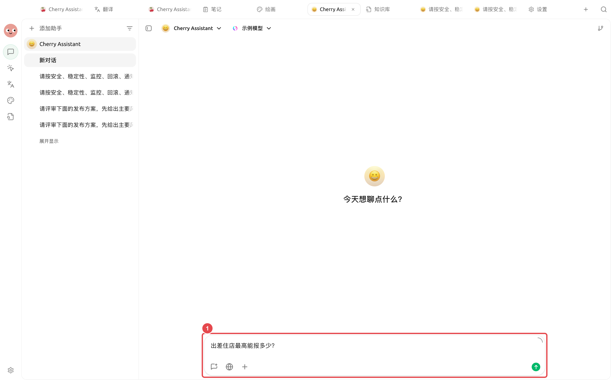
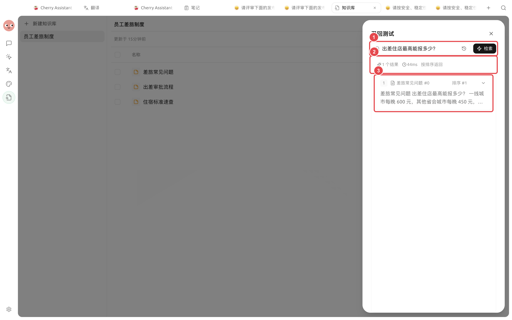
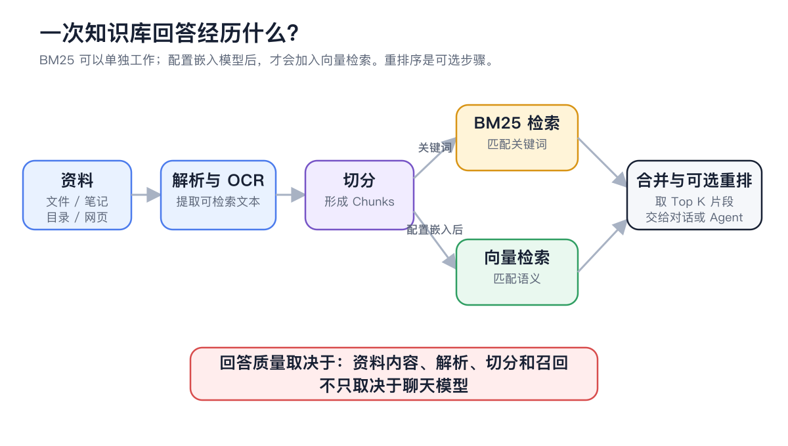

# 





## 

|  |  |
| ----- | ---------------- |
|  |  |
|  |  |
|  |  |
|  |  |





## 



### 1. 




### 2. 




### 3. 

<figure><figcaption>

</figcaption></figure>



### 4. 

``



### 5. 




### 6. 

<figure><figcaption>

</figcaption></figure>



## 

<figure><figcaption>

</figcaption></figure>

## 

### 

> 

### 

> “”“”

### 

> 





## 

|  |  |  |
| --------- | -------------- | --------------- |
|  |  |  |
|  |  |  |
|  |  |  |
|  |  |  |

## 

|  |  |  |  |
| ----- | ----------- | --------- | ------------ |
|  | 1  |  |  |
|  | “” |  |  |
|  |  |  | “” |
|  |  |  |  |

## 

SuperAgent 

## 

“”

## 

## 

<table data-view="cards"><thead><tr><th></th><th></th><th data-hidden data-card-target data-type="content-ref"></th></tr></thead><tbody><tr><td><strong></strong></td><td></td><td><a href="recall-test.md">recall-test.md</a></td></tr><tr><td><strong></strong></td><td></td><td><a href="agent.md">agent.md</a></td></tr><tr><td><strong></strong></td><td></td><td><a href="cases.md">cases.md</a></td></tr></tbody></table>
