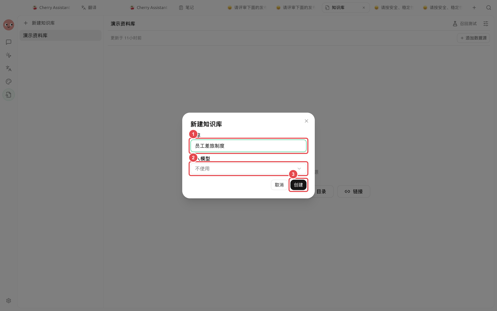
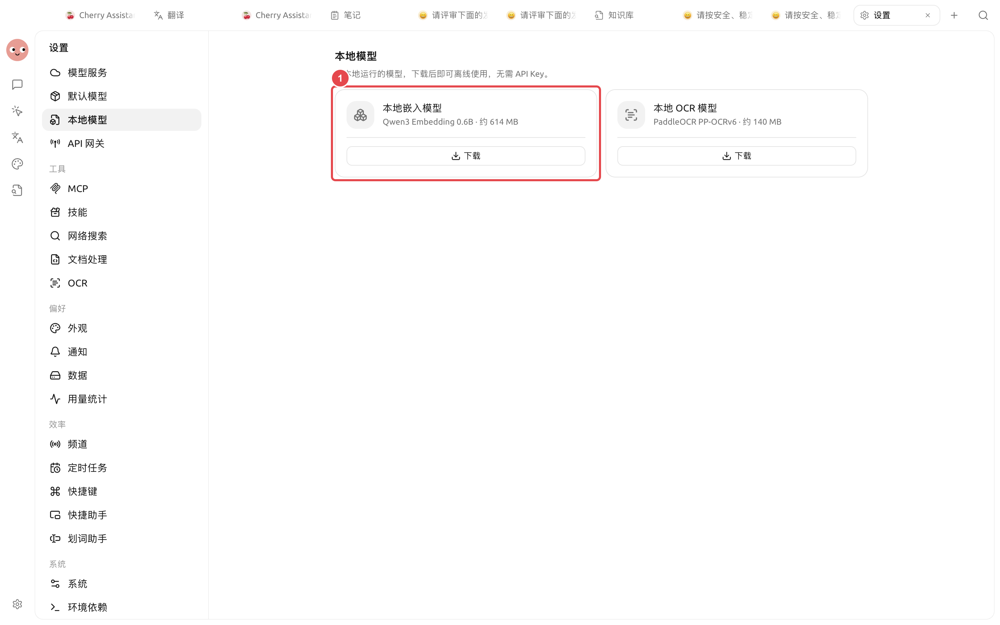

# 


 BM25 


## 

### 

“ + ”

### 

|  |  |  |  |
| ------ | ------------- | ------------- | ------------ |
|  |  | BM25  |  |
|  |  | BM25 +  |  |
|  |  | BM25 +  |  |

## 



### 1. 




### 2. 




### 3. 

<figure><figcaption>

</figcaption></figure>



### 4. 




### 5. 




## 

→

<figure><figcaption>

</figcaption></figure>





## 

 BM25 





## 

|  |  |  |  |  |  |
| ------ | ----- | ----------- | ---------- | ----------- | ------------------ |
|  |  |  +  |  |  |  |
|  |  |  |  |  |  |
|  |  |  |  |  |  |

## 

* 
* 
* 

## 

## 

 BM25 

“”

## 

<table data-view="cards"><thead><tr><th></th><th></th><th data-hidden data-card-target data-type="content-ref"></th></tr></thead><tbody><tr><td><strong></strong></td><td></td><td><a href="sources.md">sources.md</a></td></tr><tr><td><strong></strong></td><td></td><td><a href="recall-test.md">recall-test.md</a></td></tr><tr><td><strong></strong></td><td></td><td><a href="emb-models-info.md">emb-models-info.md</a></td></tr></tbody></table>
