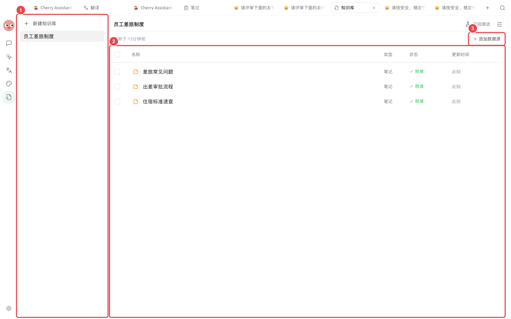
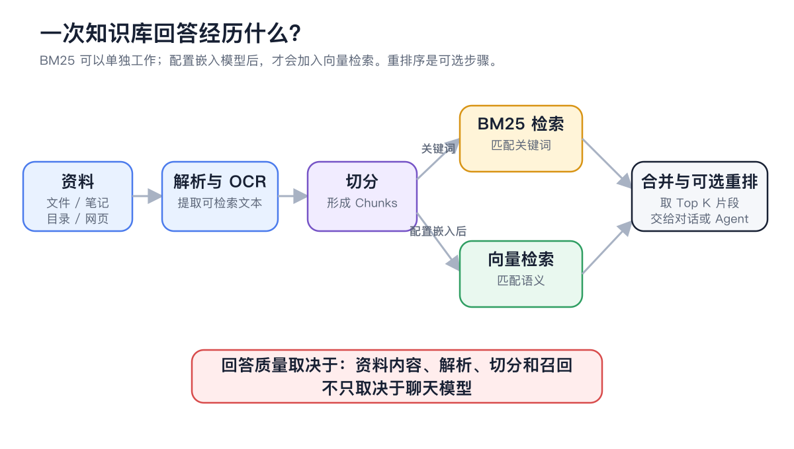

# 

Chunks OCR





## 

|  |  |  |
| ------------ | ----------- | --------------- |
|  |  |  |
|  |  |  |
|  Chunks |  |  |
| BM25  |  |  |
|  |  |  |

<figure><figcaption>

</figcaption></figure>

## 

<figure><figcaption>

</figcaption></figure>

|  |  |
| ------- | ------------- |
|  |  |
|  |  |
|  |  |
|  |  |
|  |  |


API Key


## 



### 1. 

OCR



### 2. 




### 3. 

 Chunks



### 4. 

→



### 5. 

Chunks



### 6. 




## 

|  |  |  |  |
| ---- | ------------------------ | --------------- | ----------- |
|  |  |  |  |
|  |  |  |  |





## 

### 

1. 
2. 
3. 
4.  Chunks
5. 

### 

OCR

### 

## 

|  |  |  |  |
| ---- | ---------- | ----------- | ------------ |
|  |  |  |  |
|  |  |  |  |
|  |  |  |  |
|  |  |  |  |

## 

 Chunks

## 

*  OCR 
* 
* 
* 
*  MCP

## 

OCR

## 

<table data-view="cards"><thead><tr><th></th><th></th><th data-hidden data-card-target data-type="content-ref"></th></tr></thead><tbody><tr><td><strong> OCR</strong></td><td></td><td><a href="document-preprocessing.md">document-preprocessing.md</a></td></tr><tr><td><strong></strong></td><td></td><td><a href="sources.md">sources.md</a></td></tr><tr><td><strong></strong></td><td></td><td><a href="troubleshooting.md">troubleshooting.md</a></td></tr></tbody></table>
