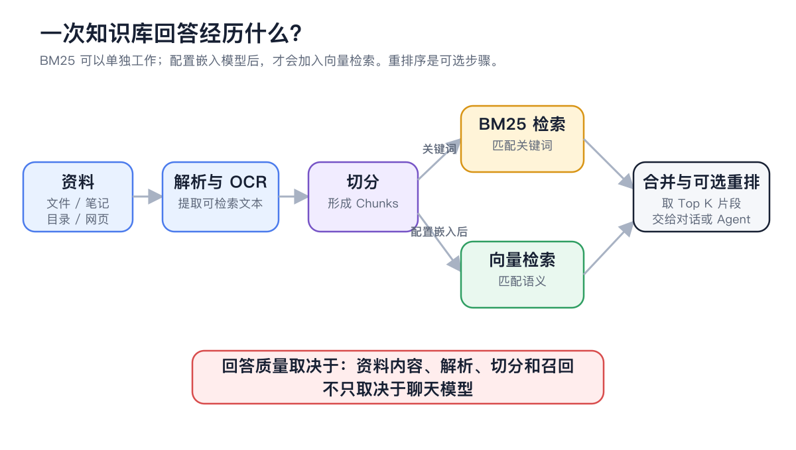
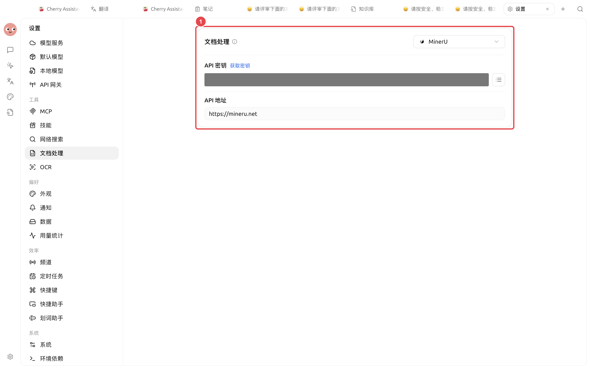
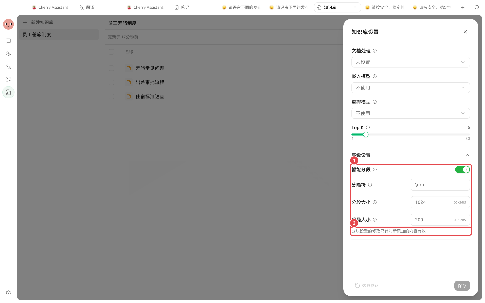

#  OCR

 PDF


“”


## 

|  |  |  |
| -------------------- | --------- | ------------- |
| MarkdownTXTHTML |  |  |
|  PDFDOCXPPTX |  |  |
|  PDF |  OCR |  |
|  PDF |  |  |

## 

<figure><figcaption>

</figcaption></figure>

## 



### 1. 

 PDF 



### 2. 

→ OCR API Key 

<figure><figcaption>

</figcaption></figure>



### 3. 

 OCR 



### 4.  Chunks

<figure><figcaption>
 Chunk 
</figcaption></figure>



### 5. 




### 6. 

OCR 




 OCR 


##  OCR 

|  |  |  |  |
| ------------ | ------------ | ---------------- | ------------------ |
|  |  |  |  |
| System OCR |  |  API Key |  |
|  PaddleOCR |  |  |  |
|  |  |  |  |


OCR


## 

|  |  |  |
| -------- | ------------- | --------------------------- |
|  |  |  OCR  |
|  |  |  |
|  |  |  Markdown  |
|  | Chunks  |  Top K |
| OCR  |  |  |

## 

|  |  |  |  |
| ----------- | -------------- | --------------- | ----------- |
|  |  |  |  |
| OCR |  |  |  |
| Chunk  |  |  |  |
|  | 35  | OCR  |  |

## 

 PDF Top K Chunks

## 

 Chunks 

 Top K 

Top K 

## 

<table data-view="cards"><thead><tr><th></th><th></th><th data-hidden data-card-target data-type="content-ref"></th></tr></thead><tbody><tr><td><strong></strong></td><td></td><td><a href="sources.md">sources.md</a></td></tr><tr><td><strong></strong></td><td></td><td><a href="recall-test.md">recall-test.md</a></td></tr><tr><td><strong></strong></td><td></td><td><a href="data.md">data.md</a></td></tr></tbody></table>
