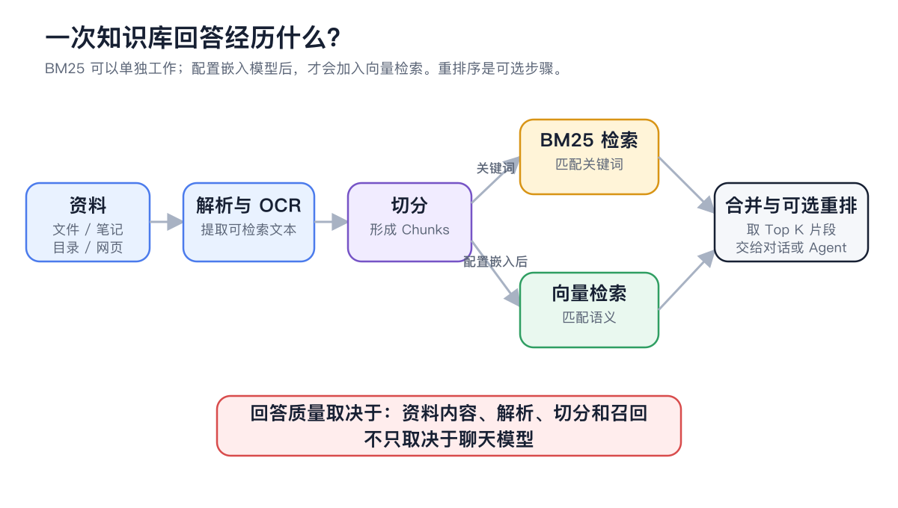
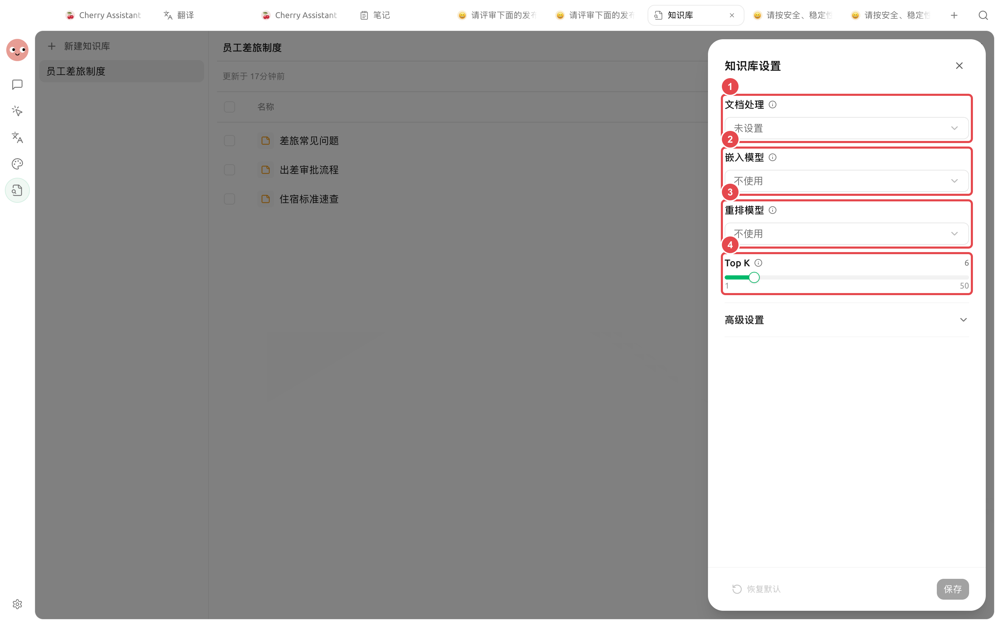
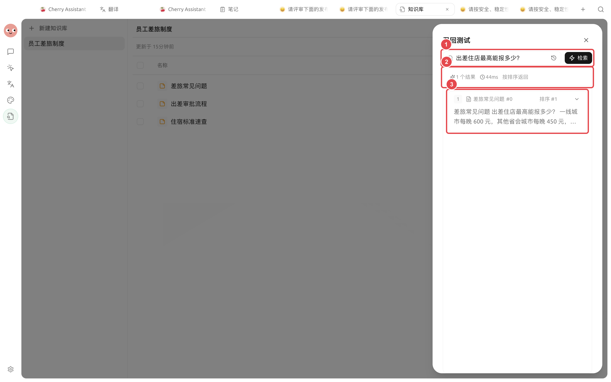
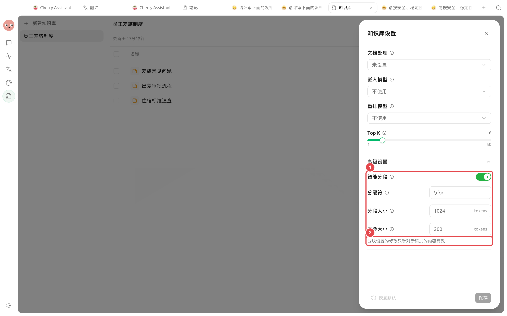
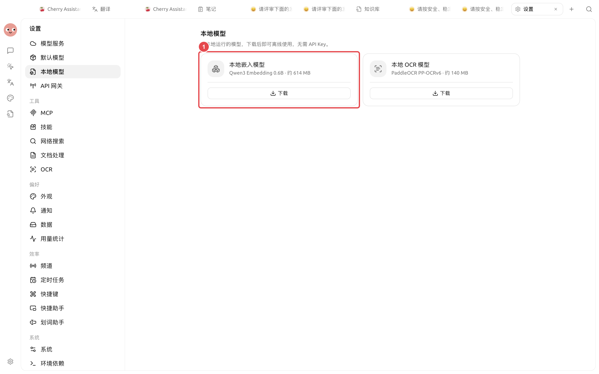
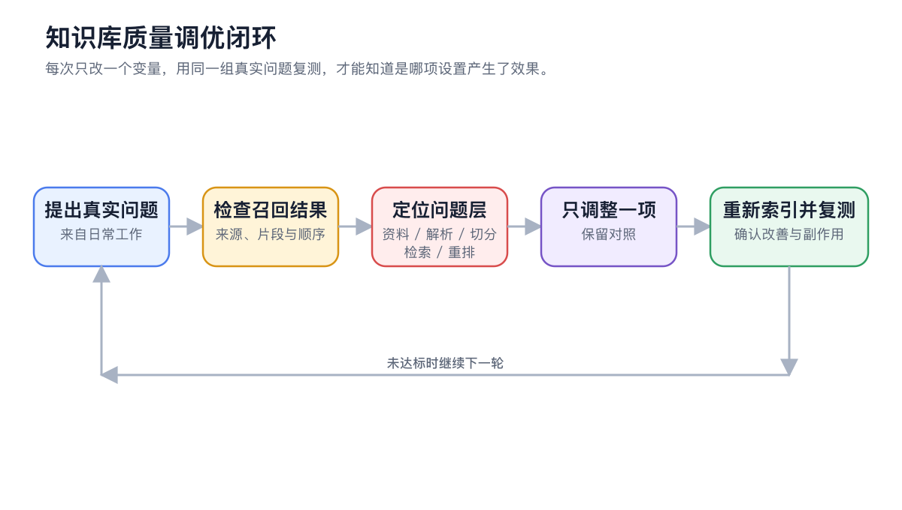

# 

 Top K “”





## 

<figure><figcaption>
BM25 
</figcaption></figure>

“”“”“”

### 

|  |  |  |  |
| ----------- | -------------------- | --------------- | -------------------- |
|  |  BM25  |  |  |
|  | BM25  |  |  |
|  +  |  |  |  0.0 |





## 

→  → 

Top K Top K  6

<figure><figcaption>
 Top K
</figcaption></figure>

### 

|  |  |  |  |
| ----- | ------------ | ---------------- | ------------------------------------- |
|  |  |  |  |
|  |  |  |  |
| Top K | 6 150 |  6 |  |
|  | 0.0 |  0.0  |  |

## 

 35 



### 1.  Chunks




### 2. 

<figure><figcaption>
“”
</figcaption></figure>



### 3. 

* 
* 
* 
* 
*  Top K



### 4. 

 Top K 



### 5. 




## 

<figure><figcaption>
 1024 200 
</figcaption></figure>

|  |  |  |  |
| ---- | ----------- | -------------------------- | ------------------ |
|  |  |  |  |
|  | `\n\n` |  |  |
|  | 1024 tokens |  |  |
|  | 200 tokens |  |  |





## 

 BM25 





→

<figure><figcaption>

</figcaption></figure>

## 

<figure><figcaption>
 →  →  →  →  → 
</figcaption></figure>

## 

“”“”

1. 
2. 
3. 
4.  Top K  6 0.0

## 

 BM25 

 Top K 

 Chunks Top K 

## 

<table data-view="cards"><thead><tr><th></th><th></th><th data-hidden data-card-target data-type="content-ref"></th></tr></thead><tbody><tr><td><strong></strong></td><td></td><td><a href="knowledge-base.md">knowledge-base.md</a></td></tr><tr><td><strong> OCR</strong></td><td></td><td><a href="document-preprocessing.md">document-preprocessing.md</a></td></tr><tr><td><strong></strong></td><td></td><td><a href="sources.md">sources.md</a></td></tr><tr><td><strong></strong></td><td></td><td><a href="recall-test.md">recall-test.md</a></td></tr></tbody></table>
