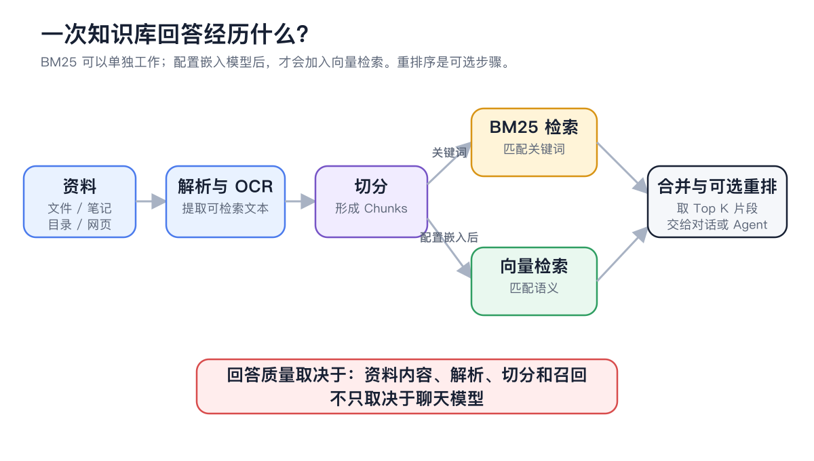
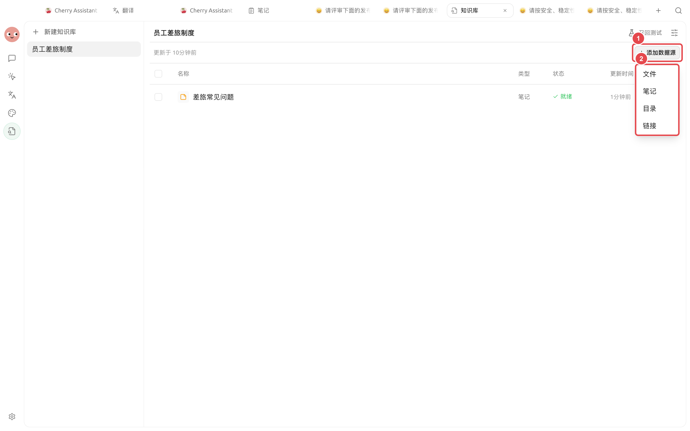
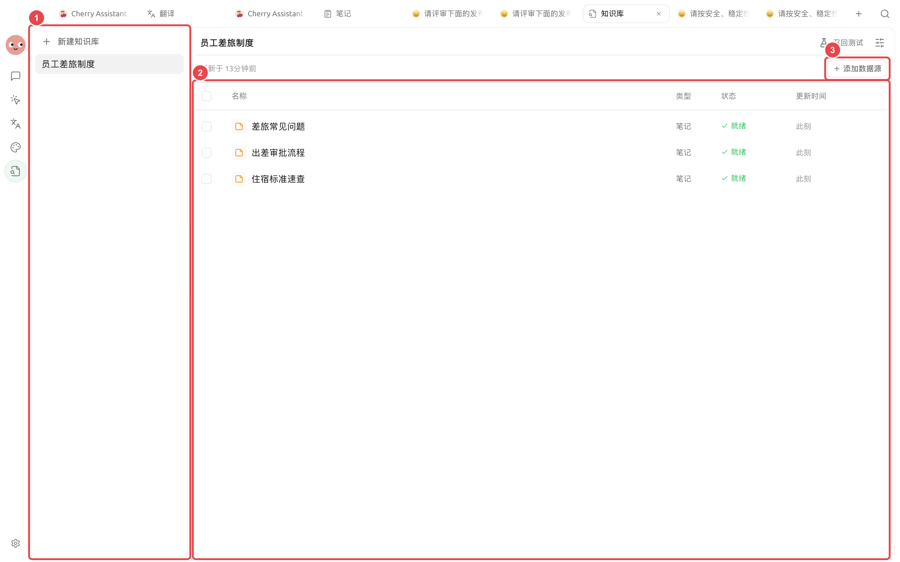

# 





## 

|  |  |  |
| ---------------- | ----------- | ---------------------- |
|  |  |  |
|  |  |  |
|  |  |  |
|  |  |  |

## 

<figure><figcaption>

</figcaption></figure>

### 

|  |  |
| ----- | ------------------------------- |
|  |  |
|  |  |
| Chunk |  |
|  |  |
|  |  |
|  |  |


 BM25 


## 5 



### 1. 

→ “ + ”



### 2. 




### 3. 

<figure><figcaption>

</figcaption></figure>



### 4. 

 Chunks

<figure><figcaption>

</figcaption></figure>



### 5. 





### 6. 




## 

|  |  |  |  |  |  |
| ------ | ----- | ----------------- | -------------- | ----------- | ------------------ |
|  | — |  |  |  |  |
|  |  |  |  |  |  |
|  | — | 35  |  |  |  |
|  | — | Chunks |  |  |  |

## 

* 
*  Chunks 
* 

## 

“”“5000 ”

## 

 Chunks

## 

<table data-view="cards"><thead><tr><th></th><th></th><th data-hidden data-card-target data-type="content-ref"></th></tr></thead><tbody><tr><td><strong></strong></td><td></td><td><a href="create.md">create.md</a></td></tr><tr><td><strong></strong></td><td></td><td><a href="sources.md">sources.md</a></td></tr><tr><td><strong></strong></td><td></td><td><a href="recall-test.md">recall-test.md</a></td></tr><tr><td><strong></strong></td><td></td><td><a href="emb-models-info.md">emb-models-info.md</a></td></tr></tbody></table>
