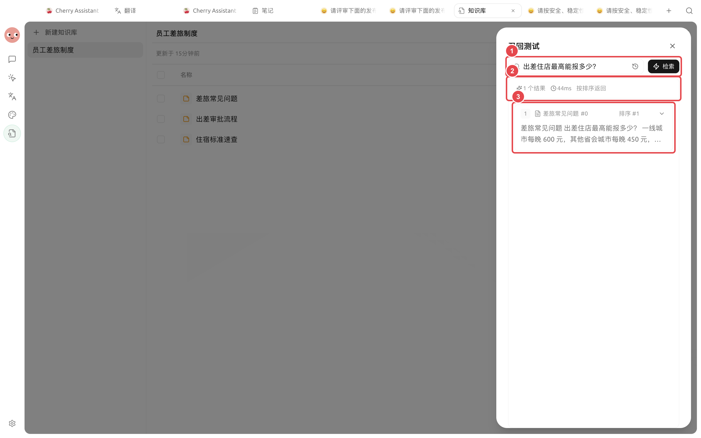
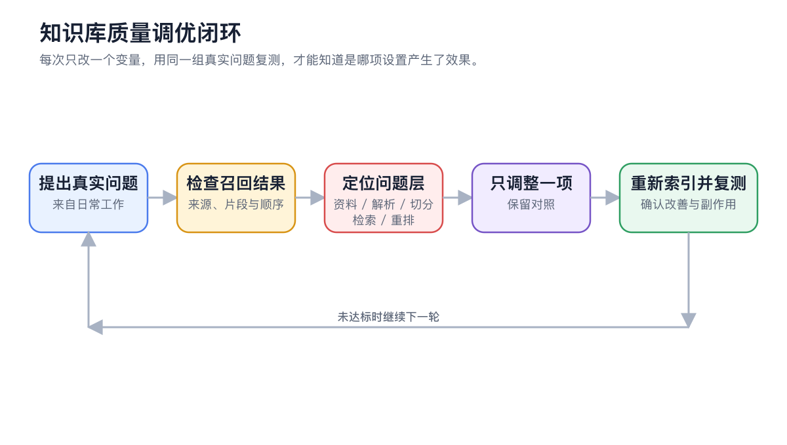
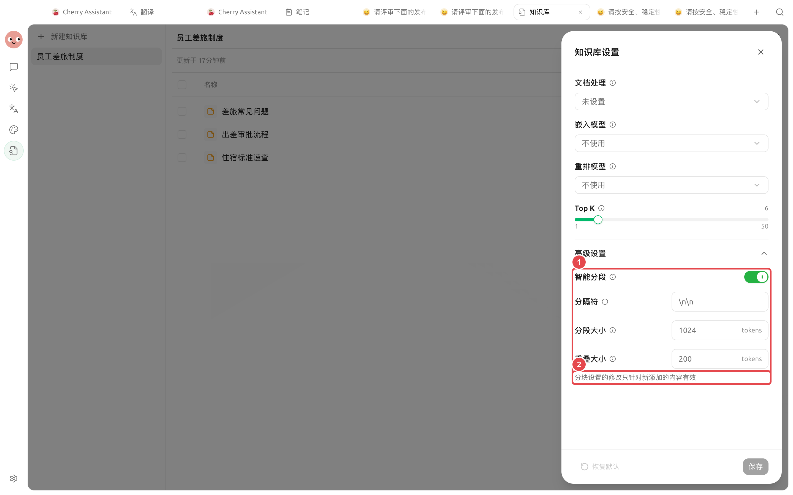

# 

“”


 35 


## 

* “”
* “”
* “5000 ”

## 



### 1. 

→  → 



### 2. 




### 3. 

<figure><figcaption>

</figcaption></figure>



### 4. 

 Top K



### 5. 




## 

|  |  |  |
| ------------- | --------------------- | ---------------------- |
|  |  |  |
|  |  | Chunks  |
|  |  |  Chunks |
|  |  |  |
|  |  |  |
|  |  |  |





## 

<figure><figcaption>
 →  →  →  →  → 
</figcaption></figure>

1. 
2.  Chunks
3. 
4. 
5. 

<figure><figcaption>

</figcaption></figure>

## 

|  |  |  |  |  |  |
| ------ | ------------ | -------- | ---------- | ---------- | ----------------- |
|  | — | 35  |  |  |  |
| Top K | 6 150 |  6 |  |  |  |
|  | 0.0 |  0.0  |  |  |  |
|  | — |  |  |  |  |

## 

* 
* 
* 
* 

## 

“”“” Chunks 

## 

 Top K 

 Chunks Top K 

## 

<table data-view="cards"><thead><tr><th></th><th></th><th data-hidden data-card-target data-type="content-ref"></th></tr></thead><tbody><tr><td><strong></strong></td><td>Top K </td><td><a href="emb-models-info.md">emb-models-info.md</a></td></tr><tr><td><strong> OCR</strong></td><td></td><td><a href="document-preprocessing.md">document-preprocessing.md</a></td></tr><tr><td><strong></strong></td><td></td><td><a href="chat.md">chat.md</a></td></tr></tbody></table>
