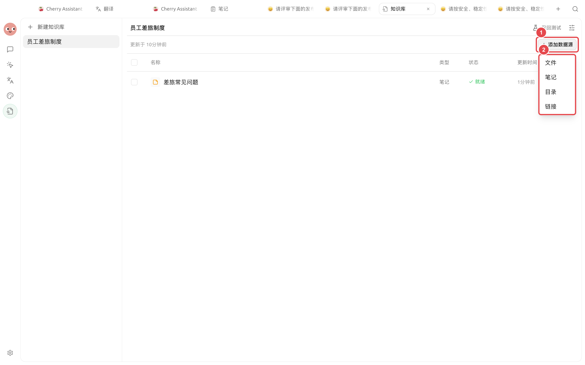
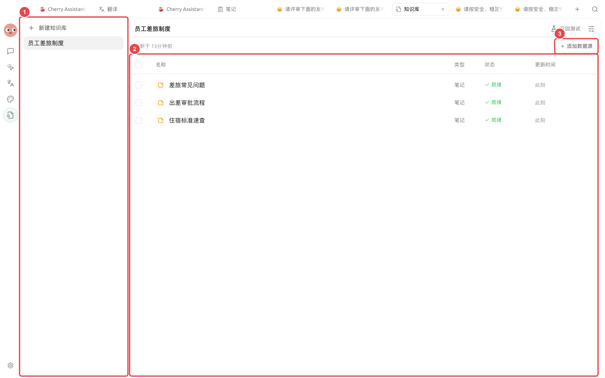
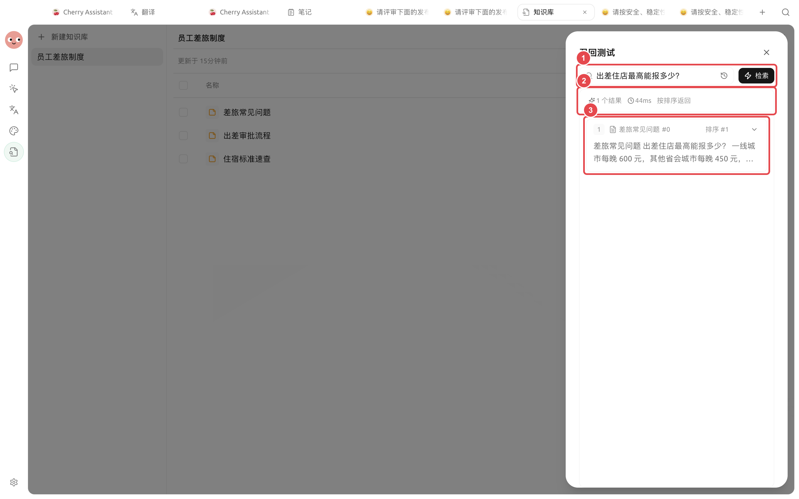

# 

SuperAgent  Chunks


“”Chunks 


## 

<figure><figcaption>
SuperAgent 
</figcaption></figure>

|  |  |  |  |
| -- | ----------------------- | ----------- | ------------------ |
|  | PDFOfficeMarkdown |  |  20  |
|  | SuperAgent  |  |  |
|  |  |  |  |
|  |  |  |  |


 PDFDOCXDOCPPTXXLSXXLSMDTXTCSVHTML  EPUB PDF  OCR


## 



### 1. 




### 2. 

 20 



### 3. 







### 4. 

<figure><figcaption>
 Chunks
</figcaption></figure>



### 5.  Chunks

 ChunksOCR 



### 6. 

<figure><figcaption>

</figcaption></figure>



## 

|  |  |  |
| ----------- | ------------------ | ------------------ |
|  |  |  |
|  |  |  |
|  |  OCR |  OCR |
| Chunk  |  |  |
|  |  |  |

## 





## 

|  |  |  |  |  |  |
| ------ | ------- | ---------- | --------------- | ---------- | ---------------- |
|  |  20  |  |  |  |  |
|  |  |  |  |  |  |
|  |  |  |  |  |  |

## 

 Chunks

## 

## 

<table data-view="cards"><thead><tr><th></th><th></th><th data-hidden data-card-target data-type="content-ref"></th></tr></thead><tbody><tr><td><strong> OCR</strong></td><td></td><td><a href="document-preprocessing.md">document-preprocessing.md</a></td></tr><tr><td><strong></strong></td><td></td><td><a href="recall-test.md">recall-test.md</a></td></tr><tr><td><strong></strong></td><td></td><td><a href="data.md">data.md</a></td></tr></tbody></table>
