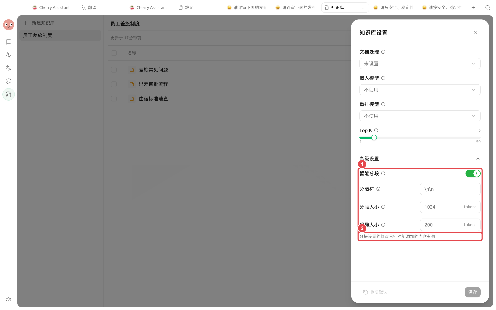
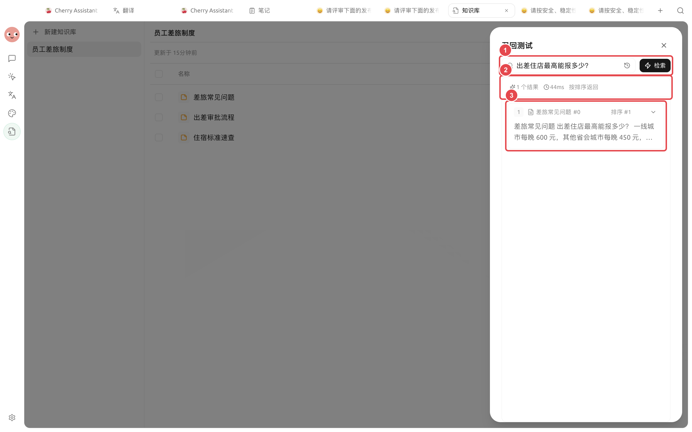
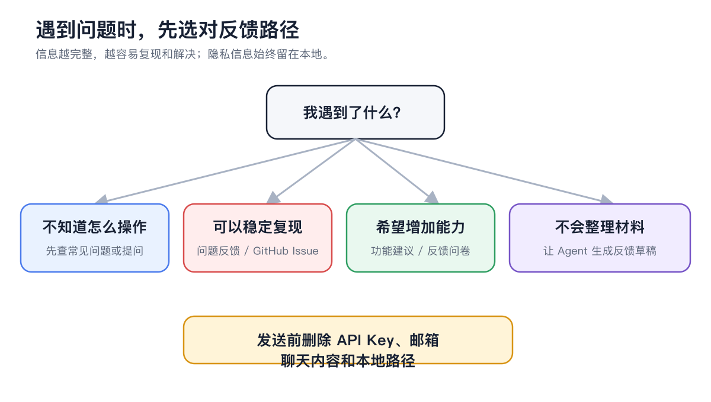

# 


Chunk 


## 5 



### 1. 




### 2. 




### 3.  Chunks

<figure><figcaption>

</figcaption></figure>



### 4. 

<figure><figcaption>

</figcaption></figure>




### 5. 




## 

<figure><figcaption>

</figcaption></figure>


 API Key


## 

 BM25 

SuperAgent  PDFDOCXDOCPPTXXLSXXLSODTODPODSRTFMarkdownTXTCSVHTML  EPUB

 20 

 OCR 

## 

 PDF 

 OCR→ OCR

 Chunk 

 Top K 

 Chunks Chunk 

Top K 

 6 Top K  150 

## 

→

## 

OCR

## 

|  |  |  |
| ----- | ------------- | ---------------- |
| Top K | 6 |  |
|  |  0.0  |  |
| Chunk |  |  |
|  | BM25  |  |
|  |  |  |

## 

“” PDF 

 Top KChunk 





## 

<table data-view="cards"><thead><tr><th></th><th></th><th data-hidden data-card-target data-type="content-ref"></th></tr></thead><tbody><tr><td><strong> OCR</strong></td><td></td><td><a href="document-preprocessing.md">document-preprocessing.md</a></td></tr><tr><td><strong></strong></td><td></td><td><a href="emb-models-info.md">emb-models-info.md</a></td></tr><tr><td><strong></strong></td><td></td><td><a href="data.md">data.md</a></td></tr></tbody></table>
