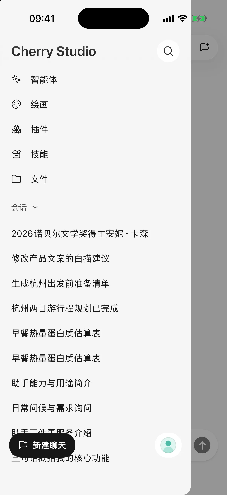
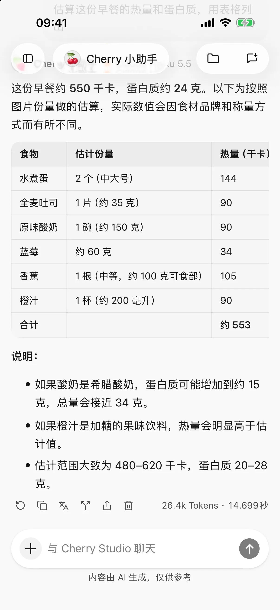

# SuperAgent 

SuperAgent  AndroidiPhone  iPad  AI 

 **0.3.0** 

- ****
- ****
- ****

<figure data-mobile-shot="phone"><figcaption>
<strong>iPhone</strong> · 
</figcaption></figure>
<figure data-mobile-shot="phone"><figcaption>
<strong>iPhone</strong> · 
</figcaption></figure>

## 

 Google Play  App Store

* Android  APKGitCode [Google Play](https://play.google.com/store/apps/details?id=com.cherryai.superagent_app) 
* iPhone  iPad [ App Store](https://apps.apple.com/cn/app/superagent-%E5%85%A8%E8%83%BD-ai-%E5%B7%A5%E4%BD%9C%E7%AB%99/id6809783714)  TestFlight 
* 

## 

### 

 ·  · 

### 

 ·  ·  ·  ·  ·  · [HTML  PPT](html-export.md) · 

### 

 ·  ·  · [ AI ](using-tools.md) ·  ·  · 

### 

 ·  ·  ·  ·  · 

### 

 ·  · 

### 

> SuperAgent 
