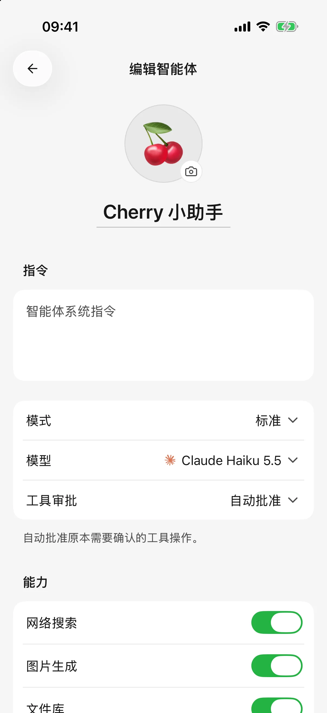

# 

## 

1. 
2. 
3. 
4. “”
5.  ****

> “”

 API Key 

<figure data-mobile-shot="phone"><figcaption>
<strong>iPhone</strong> · 
</figcaption></figure>

## 

****

## 

|  |  |  |
| --- | --- | --- |
|  |  |  |
|  |  |  |

## “”“”

|  |  |
| --- | --- |
|  |  |
|  |  |

 Cherry  **** ****

******iOS **

## 

 **** 

* 
*  MCP 
*  **** ** → ** 
* 

|  |  |  |
| --- | --- | --- |
|  | “”“ 30 ” | iOSAndroid |
|  | “” | iOS Android  |
|  | “” | iOSAndroid  |
|  | “” | iOSAndroid |
|  | “” |  |

Android 

 App

## 

* ****
* ****Notion  ** → ** 
* ** MCP**
* ****
* **** ** → **  **** 

## 

“”

[ AI ](using-tools.md)
