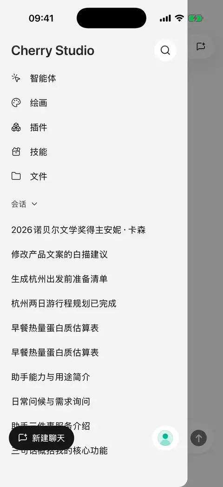

# 

## 

 ****

“”

## 

* 
* ****
*  **** 
* 

<figure data-mobile-shot="phone"><figcaption>
<strong>iPhone </strong> · “”
</figcaption></figure>
<figure data-mobile-shot="phone"><figcaption>
<strong>iPhone </strong> · 
</figcaption></figure>

## 

 ****“”

“”

 JPEGPNGGIFWebP  10 MB JPEG  PNG

 JPEGPNGWebP GIF

<figure data-mobile-shot="phone"><figcaption>
<strong>iPhone </strong> ·  →  →  → 
</figcaption></figure>

## 

1.  ** → **
2. 
3. “”

 **5 MB**PDF  **50 MB** **20 MB** MB  1024 × 1024 PDF  **100 **

PDFDOCXXLSXPPTX 

### 

 ** →  → ** 

|  |  |  |
| --- | --- | --- |
|  |  |  PDFDOCXXLSXPPTX  |
| AnyDoc |  |  PDF  |

PDF “”

**** 

 HTML [ PPT](html-export.md)

## 

|  |  |  |
| --- | --- | --- |
|  |  |  |
|  |  |  |
|  |  |  |
|  |  |  |

****

****

## 

## 

 **** “”

 ** / **

