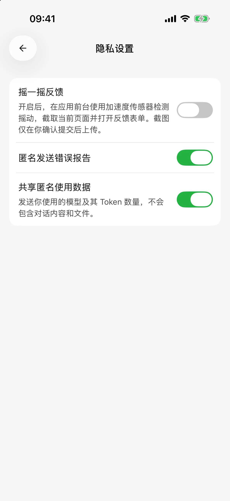
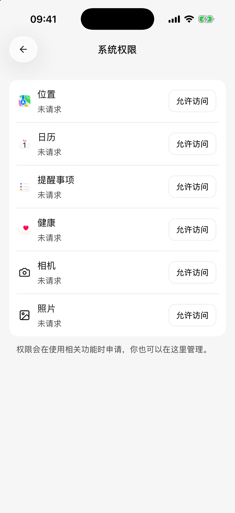

# 

## 

|  |  |
| --- | --- |
|  |  |
|  |  |
|  |  |
|  |  |
|  |  |
| iOS  |  |
|  |  |
|  |  |

“”

## 

 ****  **** ** → ** 

* **** Token  API Key
* ****

<figure data-mobile-shot="phone"><figcaption>
<strong>iPhone</strong> · 
</figcaption></figure>

## 

API Key 

 MCP 

## 

 ** → **

|  |  |
| --- | --- |
|  |  |
|  |  SuperAgent  |
|  |  |
|  |  |
|  |  |

 MCP Android  iOS 

<figure data-mobile-shot="phone"><figcaption>
<strong>iPhone</strong> · 
</figcaption></figure>

## 

 ** → **  App 

HTML  Markdown  App 

 30 

## 

## 

 ** →  → **  24 

“”

## 

