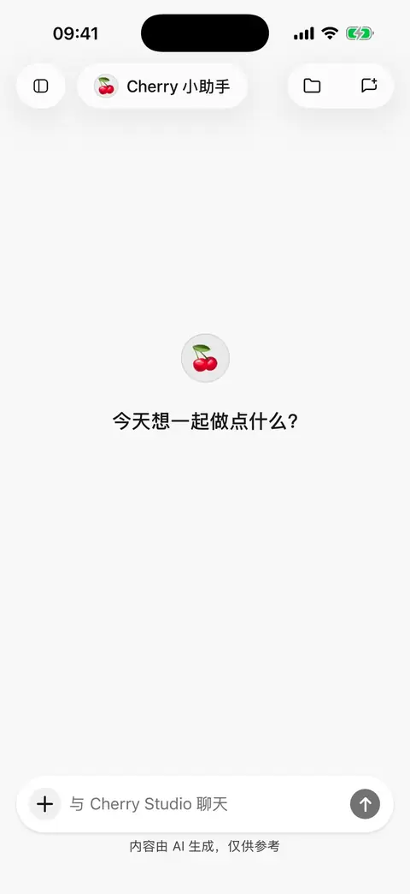

# 

 **** **0.3.0**  30 

## 

1.  **** “”
2. 
3. 
4. 

<figure data-mobile-shot="phone"><figcaption>
<strong>iPhone </strong> · 
</figcaption></figure>
<figure data-mobile-shot="phone"><figcaption>
<strong>iPhone</strong> · 
</figcaption></figure>

## 

****

1. 
2. 
3. 

> .md.md

* 
* 
* 
* 
* 

<figure data-mobile-shot="phone"><figcaption>
<strong>iPhone </strong> · “” AI 
</figcaption></figure>
<figure data-mobile-shot="phone"><figcaption>
<strong>iPhone </strong> · 
</figcaption></figure>

##  AI 

> “”

> .md “/”

********[ AI ](using-tools.md)

## 

MarkdownHTMLPDFDOCXXLSX  PPTX 

## 

1.  ****
2. 
3. 

 30 **** 

 App 
