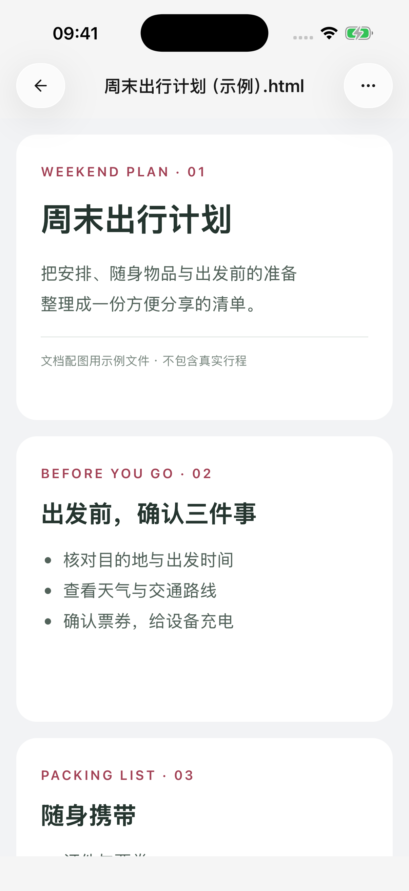
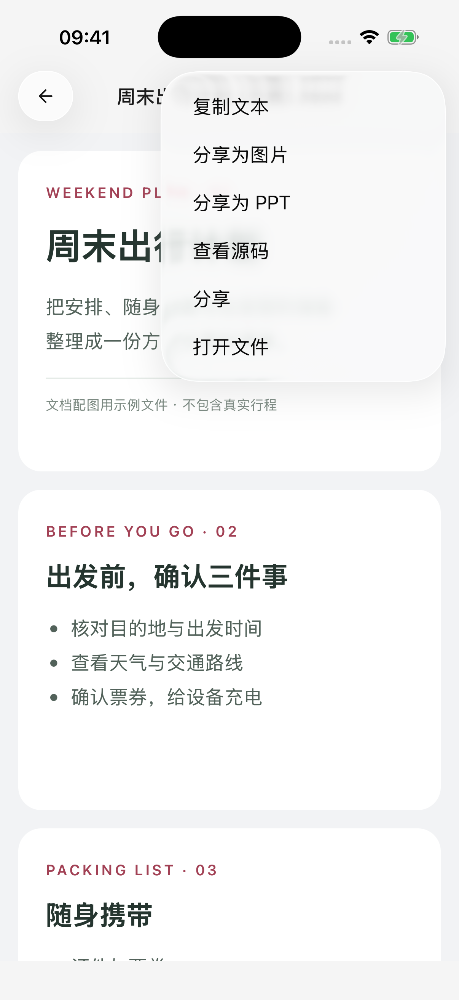

# HTML  PPT

HTML  SuperAgent  HTML  PPT

##  HTML 

>  HTML  16:9 “.html” class="slide" 

 ****  HTML 

##  PPT

1.  HTML 
2.  ****
3.  ****  ** PPT**
4.  ****
5. 

 PNG  PPTX  **** 

<figure data-mobile-shot="phone"><figcaption>
<strong>iPhone</strong> ·  HTML
</figcaption></figure>
<figure data-mobile-shot="phone"><figcaption>
<strong>iPhone</strong> ·  PPT
</figcaption></figure>

## 

|  |  |  |
| --- | --- | --- |
| PNG |  |  HTML  |
| PPTPPTX |  |  16:9  |

**PPT **  HTML HTML 

 HTML  16:9 

PPT 

## 

 ** →  → ** PPT 

 HTML PPT 

## 

* ** HTML**Markdown
* **** HTML
* ****
* ****PPT  64 
* **** App 

 HTML 
