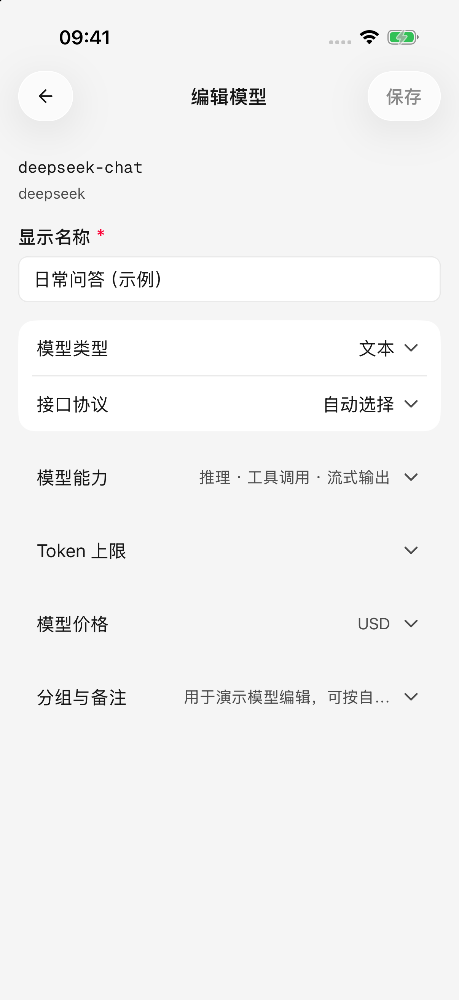
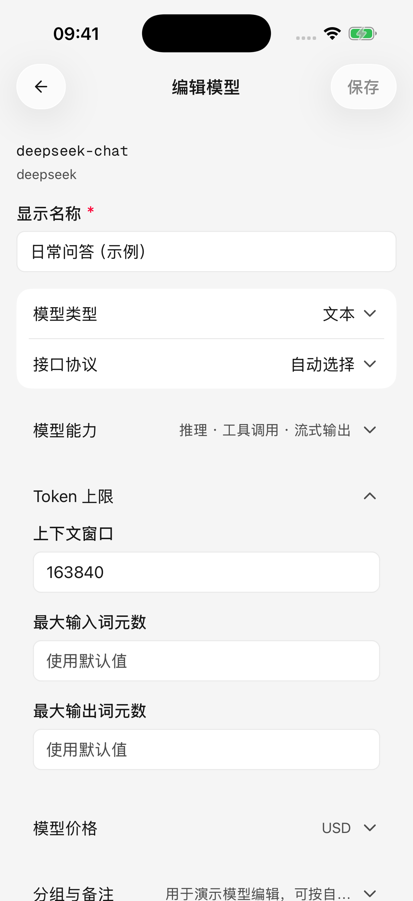
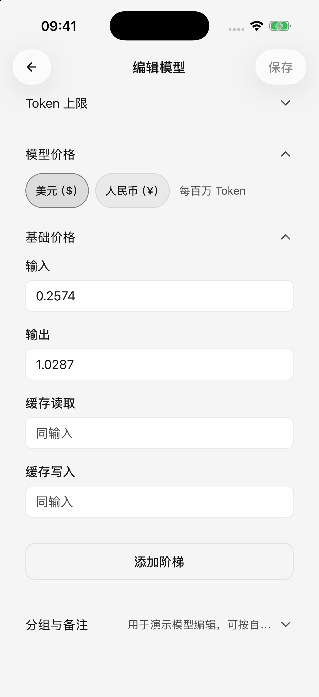

# 

** →  →  → **

## 

1. 
2.  ** ID**
3. “”“”
4. 
5.  ****

 ID

## 

 ID **** 

**** ****

 ** ID ** ID 

<figure data-mobile-shot="phone"><figcaption>
<strong>iPhone</strong> ·  ID
</figcaption></figure>
<figure data-mobile-shot="phone"><figcaption>
<strong>iPhone</strong> · 
</figcaption></figure>

## 

|  |  |  |
| --- | --- | --- |
|  |  |  |
|  ID |  |  |
|  |  |  |
|  |  |  |
|  |  |  |
|  |  |  |
|  |  |  |
|  |  |  |

**** “”

“”“”

## 

**Token**

* ****
* ****
* ****

## 

****

*  ** Token**
* 
* `0` 
* 

<figure data-mobile-shot="phone"><figcaption>
<strong>iPhone</strong> · 
</figcaption></figure>
<figure data-mobile-shot="phone"><figcaption>
<strong>iPhone</strong> ·  Token 
</figcaption></figure>

## 

****

“”

## 

*  ** → ** 
* 
* 

