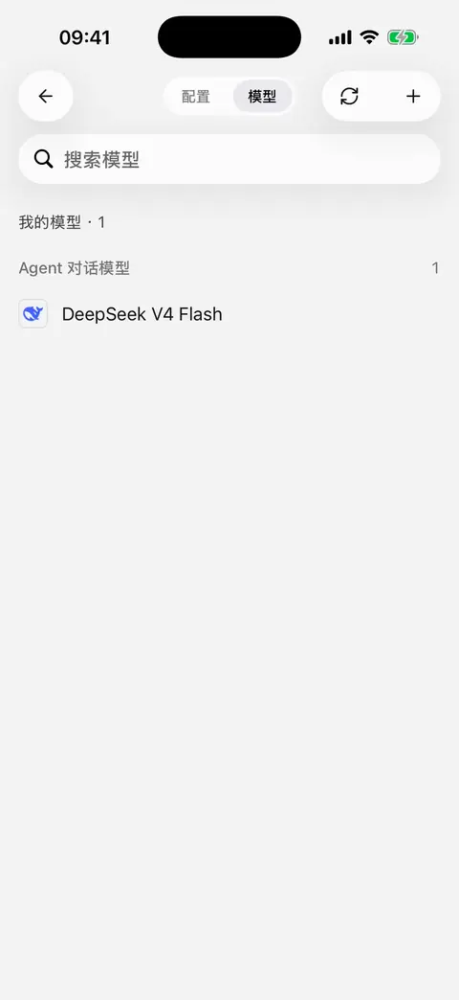

# 

“”

|  |  |  |
| --- | --- | --- |
|  |  ****  |  |
|  |  **** |  |
|  |  **** |  |
|  |  App |  |

## 

****

 **** 

## 

## 

 **API Key**

## 

1.  ** →  →  → **
2.  ****
3.  ****  **** 
4.  ****
5. 

<figure data-mobile-shot="phone"><figcaption>
<strong>iPhone </strong> · 
</figcaption></figure>

## “”

“”

## 

 **** ID

## 

1. 
2. 
3. 
4. “”

