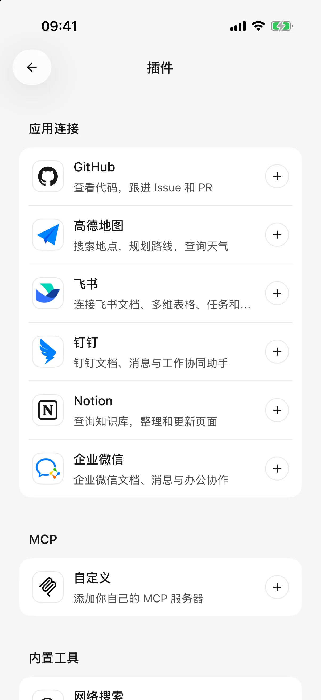

# 

 Notion 

## 

1.  ****
2. “” ****
3. 
4.  SuperAgent ****
5.  ** → **

“[]”

<figure data-mobile-shot="phone"><figcaption>
<strong>iPhone</strong> ·  MCP 
</figcaption></figure>

## 

|  |  |  |
| --- | --- | --- |
|  |  |  Lark  |
| Notion |  |  |
| GitHub |  |  |
|  |  |  **Web  Key** |
|  |  |  |
|  |  |  SuperAgent |

### 

“” App ****  App ID App Secret

### 

### 

****

### 

 5 

## 

|  |  |  |
| --- | --- | --- |
|  | “[]” |  |
| Notion | “[]” |  |
| GitHub | “ [] ” |  |
|  | “ []  [] ” |  |
|  | “[] [] ” |  |
|  | “[]” |  |

### 

1. “[]”
2. “ 12 ”

### 

“‘’”“”

Notion  Notion 

### 

[ AI ](using-tools.md)

## 

 ****  ****

## 

 ****

“” ****

##  MCP 

**MCP** 0.3.0 ** →  → MCP  → **

1.  `https://`
2.  **OAuth**
3.  `=`  `Authorization=Bearer `OAuth  App 
4. 
5. 

OAuth  ID  OAuth  Authorization 

 `npx`  `uvx` 0.3.0  iOS  HTTP OAuth 

## 

* **** MCP 
* ****
* **MCP Apps**
* ****App 

 MCP 

## 

“”

“”
